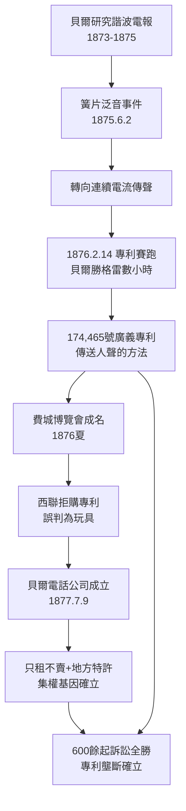

# 1.1 電話的發明與貝爾專利 (1876-1877)

> 1876 年 3 月 10 日，亞歷山大・格拉漢姆・貝爾（Alexander Graham Bell）對著一具粗糙的液體傳送器喊出：「華生先生，快來，我需要你！」——人類第一次用電線傳送了清晰的話音。一句求救，開啟了一個百年壟斷帝國。

## 一、聾啞教師的執念

貝爾（1847–1922）並非電學家出身，而是一名語言聲學教師。他的母親與妻子皆為聽障人士，這使他畢生執著於「讓聲音看得見、傳得遠」。1870 年代，他在波士頓一邊教授聾啞兒童發音，一邊研究「諧波電報」（harmonic telegraph）——企圖讓一條電報線同時傳送多組頻率的訊號。

這個看似旁門的起點，恰恰是關鍵：

- 電報巨頭西聯（Western Union）專注於點劃訊號的開關電路；
- 貝爾卻研究**連續變化的聲波電流**，思考如何把聲波的振動完整轉為電流的起伏。

1875 年 6 月 2 日，助手湯瑪斯・華生（Thomas Watson）不小心撥動了一片簧片，貝爾在另一房間聽見了簧片的泛音。他猛然醒悟：**斷續的電報觸點若能變成連續振動的電磁膜，就能傳送語音**。從此兩人全力轉向電話。

## 二、專利賽跑：貝爾 vs. 格雷

電話史上最富戲劇性的一頁，是 1876 年 2 月 14 日的專利局之爭：

| 人物 | 行動 | 結果 |
|------|------|------|
| 貝爾 | 上午遞交電話專利申請（No. 174,465） | 3 月 7 日獲准 |
| 伊萊沙・格雷（Elisha Gray） | 同日下午遞交「液體傳送器」意向書（caveat） | 晚了數小時，終身訴訟敗訴 |

後世爭論了 150 年：貝爾是否竊取了格雷的液體傳送器構想？歷史證據顯示，貝爾 1876 年 3 月 10 日首次通話成功的液體傳送器，確實與格雷的設計極為相似；但貝爾專利的核心主張是更上位的概念——**「以連續電流傳送人聲的方法」**，範圍極廣。這一寬泛的權利要求，成為日後貝爾公司橫掃 600 餘起訴訟的法律巨棒。

用今日語言說，貝爾拿到的不是一個產品專利，而是一個**基礎方法專利（foundational patent）**，其壟斷強度可用簡單模型理解：

$V_{壟斷} = 範圍_{權利要求} \times 期限_{17年} \times 執行力_{訴訟資本}$

三者皆滿格，遂形成美國史上最徹底的專利壟斷之一。

## 三、從專利到公司：1877 年的關鍵一跳

專利到手後，貝爾的岳父加德納・哈伯德（Gardiner Hubbard）與資助人桑德斯（Thomas Sanders）迅速行動：

1. **1876 年費城百年博覽會**：巴西皇帝佩德羅二世親試電話，驚呼「我的天，它會說話！」媒體引爆，電話一夜成名。
2. **西聯的誤判**：哈伯德曾開價 10 萬美元把電話專利賣給西聯總裁，被輕蔑拒絕——西聯認為電話只是電報的玩具。這是商業史上最昂貴的誤判之一。
3. **1877 年 7 月 9 日，貝爾電話公司（Bell Telephone Company）成立**，資本額初期僅約數十萬美元，卻手握傳送人聲的唯一合法權利。

公司成立之初即採**專利授權＋地方特許**模式：母公司持有專利，向各地代理商出租電話機（只租不賣），收取租金。這種「不賣斷、只收租」的設計，確保了中央對全網的永久控制——AT&T 此後百年的集權基因，在此已寫下第一行程式碼。

## 四、為什麼是貝爾贏？

- **法律上**：廣義權利要求＋強大律師團，600 餘起訴訟無一敗訴（含對西聯的關鍵和解，西聯 1879 年被迫退出電話業、讓出愛迪生碳粒麥克風專利）。
- **商業上**：哈伯德的資本運作＋只租不賣的控制模式。
- **技術上**：貝爾團隊迅速吸收愛迪生、休斯等人的麥克風改進，補上實用化的短板。
- **時勢上**：電報網已教育市場接受「付費傳訊」，電話只需替換內容物——從點劃變為人聲。

## 因果鏈

> **前因**：諧波電報研究（因）→ 泛音事件的頓悟（緣）→ 廣義專利（果）；西聯的傲慢（因）→ 拒購（果），反為貝爾留下完整的壟斷空間。
> **本節驅動後果**：174,465 號專利的 17 年排他期（至 1893–1894 年），直接驅動下一節的兩件事——(1) 貝爾公司用專利壁壘絞殺 600 餘家挑戰者，累積第一桶壟斷資本；(2) 專利到期前夕的恐慌，迫使公司必須從「專利壟斷」轉向「系統壟斷」，從而催生 AT&T 長途子公司（1885）與 Vail 的「One System」體制。換言之，**專利的有限期限，正是 Vail 體制誕生的倒數計時器**。
