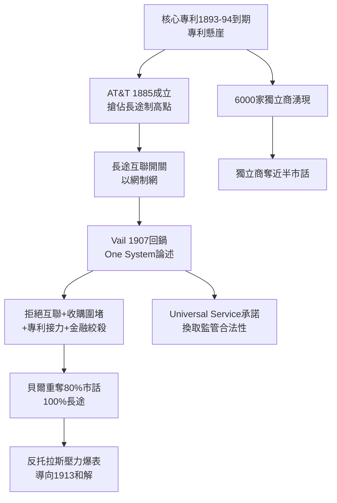

# 1.2 Vail 體制與通用服務 (1878-1907)

> 「One Policy, One System, Universal Service」（一種政策、一種系統、普及服務）。——西奧多・韋爾（Theodore N. Vail），1907 年年報。這句口號把一家電話公司包裝成了國家使命，也把壟斷包裝成了美德。

## 一、專利懸崖前的焦慮：AT&T 的誕生

貝爾的核心專利將在 1893–1894 年到期。專利壟斷是倒數計時的壟斷——到期之後，任何人皆可造電話。貝爾管理層在 1880 年代做了兩個決定，其深遠程度不亞於電話發明本身：

1. **垂直整合**：1881 年收購西方電氣（Western Electric）控股權，掌握設備製造；各地貝爾運營公司負責市話，形成「母公司—子公司」家族。
2. **1885 年成立美國電話電報公司（American Telephone and Telegraph, AT&T），作為貝爾系統的長途子公司**，任務只有一個：用長途線把各地孤島連成全國一網。

當時市話是賺錢的，長途是賠錢的（銅線昂貴、訊號衰減嚴重，波士頓—紐約已是極限）。為什麼要做賠錢的長途？答案是戰略：**誰掌握長途，誰就掌握互聯的開關**。地方獨立電話公司可以自建市話網，卻建不起橫貫大陸的長途網；只要 AT&T 拒絕與之互聯，它們就只是孤島。這是一招「以網制網」的陽謀。

1899 年，AT&T 反過來吞併母公司（資產重組），成為整個貝爾系統的控股母公司。名稱上的子公司，成了實質上的帝國中樞。

## 二、Vail：從總經理到先知

西奧多・韋爾（1845–1920）是理解 AT&T 的第一把鑰匙。他 1878 年任貝爾總經理，建立了特許經營體系；1887 年因與董事會不和離職；1907 年金融恐慌、AT&T 股價崩跌之際，被請回擔任總裁。

回鍋的 Vail 判若兩人——從經理人變成了政治家。他提出三大戰略：

### 1. 系統思維（One System）

電話的價值服從網路效應：用戶數 $n$ 的網路，其潛在連接價值約為 $O(n^2)$ 。分裂的網路互相不聯通，總價值遠小於統一大網。Vail 宣稱：電話業是**天然壟斷（natural monopoly）**，競爭只會造成重複投資與互聯斷裂，統一系統對公眾最有利。

### 2. 普及服務（Universal Service）

承諾把電話鋪到每一個農場與小鎮——即使偏遠線路虧損，也以城市利潤交叉補貼。這在 1907 年是石破天驚的承諾：把奢侈品電話重新定義為全民基礎設施。

### 3. 政治交換：以受監管換取壟斷

Vail 主動擁抱政府監管：「我們願意接受公用事業監管，換取獨占地位的承認。」這是與進步主義時代（Progressive Era）政府的一場交易——政府得到對巨獸的韁繩，AT&T 得到排他執照。

在 Vail 任內（1907–1919），AT&T 完成了：

- 收購西聯電報（1909–1913，後被迫吐出，見下一節）；
- 開發加載線圈（pupin coil）與真空管中繼器，1915 年實現橫貫大陸電話（紐約—舊金山）；
- 建立統一的工程標準與長途費率體系。

## 三、獨立電話商的反抗與絞殺

1894 年專利到期後，美國冒出 6000 餘家獨立電話公司，一度佔去近半話機。Vail 的反擊是教科書級的壟斷戰術組合：

- **拒絕互聯**：獨立商用戶打不進貝爾長途網，商業價值大減；
- **收購與圍堵**：在獨立商盈利的城市降價競爭、虧損硬撐，拖垮後廉價收購；
- **專利接力**：新專利（加載線圈、中繼器、自動交換機外圍專利）接替舊專利，技術壁壘不斷續杯；
- **金融絞殺**：透過摩根（J.P. Morgan）財團影響信貸，使獨立商融資困難。

到 1907 年，貝爾系統重奪約 80% 話機與幾乎 100% 長途。獨立商向政府哭訴，司法部反托拉斯壓力陡增——這直接引爆下一節的金士伯承諾。

## 因果鏈

> **前因**：上一節的廣義專利（因）註定了 1894 年專利懸崖（果）；懸崖催生的獨立商競爭（因），反過來迫使貝爾從專利壟斷升級為系統壟斷（果）——AT&T 長途子公司正是為此而生。
> **本節驅動後果**：Vail 用「天然壟斷＋普及服務」論述暫時說服了公眾（果），卻也把 AT&T 推到政治風口——市佔率越高，司法部的刀越近（果）。Vail 體制越成功，1913 年政府被迫出手的機率就越大。本節的壟斷勝利，正是下一節「金士伯承諾」的直接起因：**不做一點讓步讓步，就要失去一切**。
