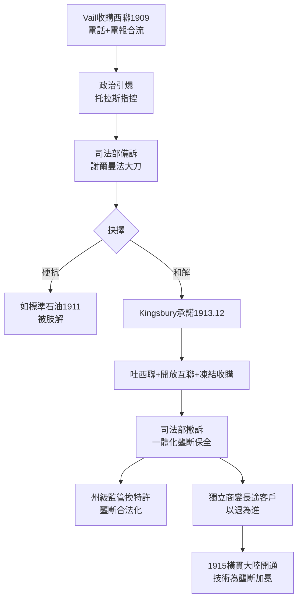

# 1.3 金士伯承諾與壟斷合法化 (1909-1913)

> 1913 年 12 月 19 日，AT&T 副總裁金士伯（Nathan Kingsbury）致函司法部，承諾吐出西聯、開放互聯、停止收購獨立商。這封信被稱為 Kingsbury Commitment——美國大企業第一次以「自我約束」換取「壟斷存續」，AT&T 則第一次學會：讓步是最高級的進攻。

## 一、導火線：吞下西聯

1909 年，在摩根財團支持下，Vail 斥資收購了西聯電報的控股權。電話＋電報，一網打盡。這步棋在商業上是天才，在政治上是自殺：

- 進步主義總統塔夫脫（Taft）與後來的威爾遜（Wilson）本就高舉反托拉斯大旗；
- 國會議員指控 AT&T 意圖壟斷一切遠距通訊；
- 獨立電話商聯盟遊說司法部長，稱貝爾是「通訊托拉斯」；
- 司法部已備好訴狀，援引 1890 年《謝爾曼法》起訴 AT&T。

Vail 面臨抉擇：硬抗到底（可能被肢解，如 1911 年的標準石油），或主動和解。Vail 選擇了後者——與其被法院切碎，不如自己動刀，切下小指保住全身。

## 二、承諾的三刀

Kingsbury Commitment（1913）的三項核心讓步：

1. **吐出西聯**：剝離西聯電報持股，承諾不再收購電報業。電話歸貝爾，電報還給市場。
2. **開放互聯**：在滿足條件下，允許獨立電話公司接入貝爾長途網。這是美國通訊史上第一次「強制互聯」原則。
3. **收購凍結**：未經州際商務委員會（ICC）批准，不再收購與之競爭的獨立電話公司（後移交 FCC，1934 年後）。

作為交換，司法部**撤銷起訴**，AT&T 的一體化壟斷（本地＋長途＋設備製造）得以完整保留。從結果看，這是一筆極划算的交易：

- 吐掉的是邊緣資產（電報已走下坡）；
- 保住的是核心資產（長途網＋西方電氣＋各地貝爾公司）；
- 開放互聯看似讓步，實則把獨立商變成長途網的付費客戶——它們越發展，AT&T 的長途收入越高。

## 三、壟斷合法化的開端

金士伯承諾的歷史意義遠超一紙和解：

- **模式創新**：開創「同意令（consent decree）」治理模式——政府不拆分企業，企業以行為承諾換取存續。此模式在 1956、1982 年兩度重演，AT&T 堪稱美國同意令史的主角。
- **監管俘獲的起點**：AT&T 此後積極擁抱州級公用事業委員會監管，以「成本加成」費率換取各州排他特許。到 1920 年代，全美多數州實質承認貝爾的本地壟斷。
- **1918 年國有化插曲**：一次大戰期間，政府短暫接管電話網（1918.7–1919.7），戰後歸還。這反而證明了全國一網的戰略價值，鞏固了 Vail「統一系統最有效率」的論述。

1915 年橫貫大陸電話開通（紐約—舊金山，Vail 與貝爾象徵性通話）是這一章的華彩尾聲：技術的勝利為壟斷加冕。公眾聽到的是「人類征服了距離」，Vail 聽到的是「沒有人能再複製這張網」。

## 因果鏈

> **前因**：上一節 Vail 絞殺獨立商的成功（因）→ 市佔率過高觸發反托拉斯調查（果）；收購西聯（因）→ 成為壓垮駱駝的最後一根稻草（果）。
> **本節驅動後果**：金士伯承諾以戰術性讓步保住戰略性壟斷（果），直接開啟第二章的「黃金年代」——未來 60 年，AT&T 在「受監管的壟斷」溫室中，建成全球最強的長途網與貝爾實驗室。更重要的是，它確立了 AT&T 與政府的互動範式：**每一次危機都以同意令化解，每一次同意令都為下一次危機埋下種子**——1956 年同意令的專利開放條款，正是 1974 年反托拉斯大戰的遠因。
