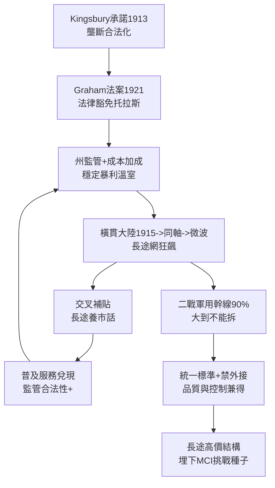

# 2.1 長途網路與全國一體化 (1913-1945)

> 到 1930 年代，美國人拿起話筒，幾乎意識不到 3000 英里外有 130,000 根電桿、數千個中繼器在為他服務。這種「理所當然」，正是 AT&T 黃金年代最深的護城河。

## 一、溫室裡的巨獸

金士伯承諾之後，AT&T 進入了美國商業史上最舒適的 60 年：各州公用事業委員會核定費率（成本＋合理報酬），利潤穩定如國債；排他特許擋住競爭者；《格雷厄姆法案》（Graham Act, 1921）更豁免電話業的反托拉斯適用，實質以法律確認壟斷。

壟斷的利潤去了哪裡？一部分變成股息（AT&T 是當時全球最大散戶持股公司，「電話寡婦」靠它收息養老），另一部分變成了人類史上最宏大的基礎設施投資：

- **1915**：紐約—舊金山橫貫大陸線開通，動用 2500 噸銅線、130,000 根電桿、3 個真空管中繼站；
- **1920s**：載波多工（carrier multiplexing），一對線可傳多路通話，長途成本驟降；
- **1930s**：同軸電纜（coaxial cable）試驗，一條可載數百路；
- **1940s**：微波中繼（microwave relay）與 L 載波系統，二戰軍需更加速其部署。

費率結構暗藏玄機：**長途高價補貼市話低價**（交叉補貼 cross-subsidy）。城市家庭月租僅數美元，偏遠農場也能裝電話——Vail 的普及承諾兌現了。但代價是長途用戶（主要是企業）支付了遠高於成本的價格。這套結構在壟斷下無人質疑，卻在 1970 年代成為 MCI 等挑戰者「奶油脫脂」（cream-skimming）的靶心——專攻高利潤長途，不管虧損市話。

## 二、二戰：國家的神經系統

1941–1945 年，貝爾系統承載了約 90% 的美國軍用長途通訊。AT&T 與軍方合作開發：

- 加密語音（SIGSALY 系統，貝爾實驗室傑作）；
- 雷達與火控相關電子技術；
- 全國幹線的備援與加密改造。

戰爭證明了全國一網的軍事價值，也讓 AT&T 與華府結成「軍工—通訊複合體」。戰後，政府對拆分 AT&T 投鼠忌器——誰敢拆掉國防的神經系統？這種「大到不能拆」的地位，保了 AT&T 又 30 年。

## 三、統一標準的力量

AT&T 堅持全網統一技術標準：統一話機（西方電氣製造）、統一交換機、統一維運規程。好處是品質穩定、互通無礙；壞處是扼殺多樣性——用戶不能外接任何非貝爾設備（此禁令直到 1968 年 Carterfone 才打破）。

可以用一個不等式概括黃金年代的邏輯：

$\text{壟斷利潤} \rightarrow \text{基礎設施投資} \rightarrow \text{服務品質} \rightarrow \text{監管合法性} \rightarrow \text{壟斷利潤}$

這是一個自我強化的正迴圈，轉了整整兩代人。

## 因果鏈

> **前因**：金士伯承諾換來的監管溫室（因）→ 壟斷利潤轉化為長途網投資（果）；一戰國有化證明一網的價值（因）→ 二戰更深化軍方依賴（果）。
> **本節驅動後果**：全國一體化長途網（果）成為貝爾實驗室的物質基礎——沒有全網的工程難題，就沒有資訊理論與電晶體的用武之地（下一節）；而交叉補貼的高長途價格（果），則為 1960–70 年代 MCI 的「奶油脫脂」訴訟埋下經濟誘因，直接導向第三章的分拆大戰。**溫室養出了參天大樹，也養出了體制的脆弱**。
