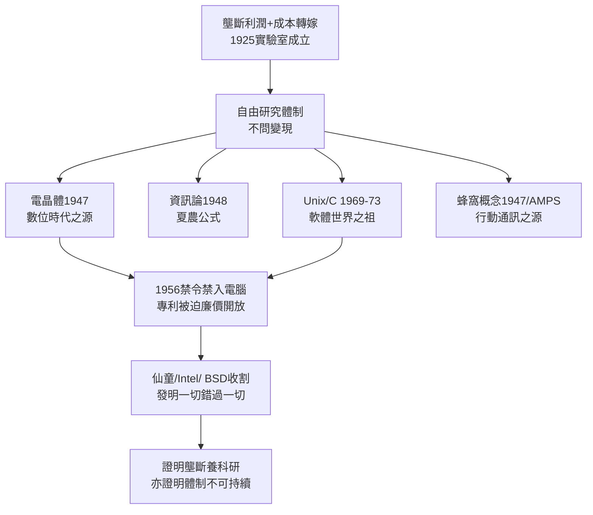

# 2.2 貝爾實驗室群星 (1925-1970)

> 「貝爾實驗室是美國最偉大的發明工廠，一個拿壟斷利潤資助人類文明的奇怪機構。」——《財星》雜誌。電晶體、資訊理論、Unix、C 語言、蜂窩電話、雷射、太陽能電池，皆誕生於新澤西州墨累山（Murray Hill）那棟米色小樓。

## 一、為什麼壟斷能養出科學聖殿？

1925 年，AT&T 將工程部與西方電氣研究部合併，成立**貝爾電話實驗室（Bell Telephone Laboratories）**。其經費來自全網電話費的固定提成——每年數億美元，不問回報、不設 KPI。這種「壟斷稅資助基礎研究」模式，在市場競爭下不可想像，在監管溫室中卻理所當然：監管機構允許把研究費計入成本，轉嫁給用戶。

實驗室奉行「先有星辰大海，再問商業變現」：聘用數學家、物理學家、冶金學家，給予終身自由。主管名言：「雇最聰明的人，然後別管他們。」

## 二、群星譜：四次改寫人類文明

### 1. 電晶體（1947）：巴丁、布拉頓、蕭克利

為替代笨重耗能的真空管中繼器，固態物理小組於 1947 年 12 月發明點接觸電晶體，1956 年三人同獲諾貝爾獎。沒有電晶體，就沒有積體電路、沒有矽谷、沒有數位時代。諷刺的是，AT&T 因受監管不能做電腦，只能以低價授權電晶體專利——仙童（Fairchild）、德儀（TI）撿走金礦，開創了半導體產業。

### 2. 資訊理論（1948）：夏農（Claude Shannon）

夏農 1948 年論文《通訊的數學理論》定義了位元（bit）與通道容量公式：

$C = B \log_2\left(1 + \frac{S}{N}\right)$

一切現代通訊（從 5G 到深空探測）皆立於此式之上。夏農研究電話中繼的雜訊問題，卻順手奠基了整個資訊時代。

### 3. Unix 與 C（1969–1973）：湯普遜、里奇

貝爾實驗室 1969 年退出 Multics 計畫後，肯・湯普遜（Ken Thompson）在一台閒置 PDP-7 上寫出 Unix，丹尼斯・里奇（Dennis Ritchie）發明 C 語言重寫之。Unix 的「一切皆檔案」、管道哲學，成為 Linux、macOS、Android、網際網路伺服器的祖先。AT&T 因 1956 同意令禁入電腦業，只能以象徵性價格授權 Unix 給大學——柏克萊 BSD、開源運動皆源於此。

### 4. 蜂窩概念（1947–1971）與其他

1947 年貝爾工程師 Ring 提出蜂窩式行動通訊構想；1971 年提交 AMPS 蜂窩系統提案。另有雷射（1958 Townes & Schawlow 理論）、太陽能電池（1954）、CCD（1969，數位相機之源）。9 座諾貝爾獎、無數 IEEE 里程碑。

## 三、天才的詛咒：發明一切，錯過一切

貝爾實驗室的悲劇在於：**能發明未來，不能擁有未來**。1956 年同意令禁止 AT&T 經營非通訊業務，電晶體與 Unix 的商業果實盡數外流。這是監管溫室的另一面——以壟斷利潤養研究，以禁令阻止變現。

| 發明 | 商業收割者 | AT&T 所得 |
|------|-----------|-----------|
| 電晶體 | 仙童、TI、Intel | 專利授權微利 |
| Unix/C | BSD、大學、Sun、微軟間接受益 | 象徵性授權費 |
| 蜂窩概念 | 摩托羅拉（首支手機 1983） | 監管拖延，商用落後 |
| 雷射/光纖基礎 | 康寧、朗訊分拆後 | 間接支配 |

## 因果鏈

> **前因**：長途網的工程難題與壟斷利潤（因）→ 養出不計回報的貝爾實驗室（果）；金士伯承諾以來的監管默契（因）→ 允許研究費轉嫁用戶（果）。
> **本節驅動後果**：實驗室的輝煌（果）反噬母公司——電晶體與電腦技術的擴散（果）催生了電腦與通訊融合的新產業，司法部據此主張「AT&T 的禁入電腦條款已過時、其壟斷已蔓延至資訊業」，成為 1974 年反托拉斯訴訟的知識背景；同時，廉價開放的專利（果）養大了未來的掘墓人（MCI、矽谷新貴）。**AT&T 資助了埋葬自己的鏟子**。
