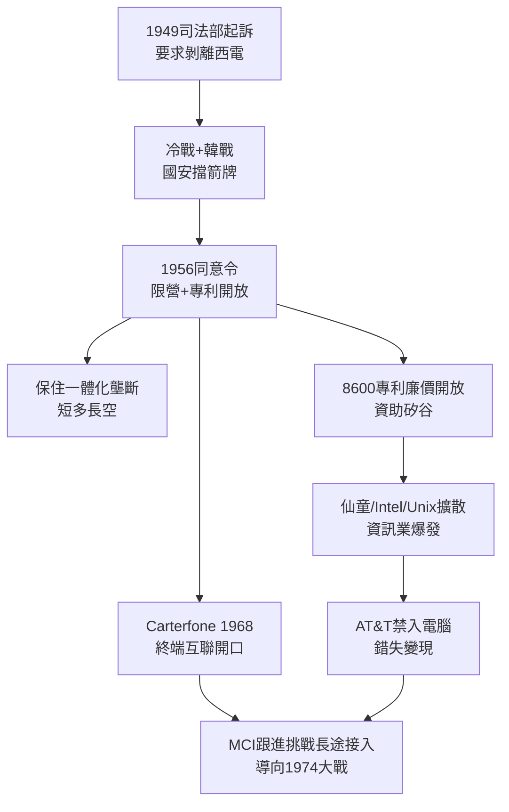

# 2.3 1956同意令與開放專利 (1949-1968)

> 1949 年司法部起訴，1956 年和解：AT&T 交出全部專利、退出電腦業，換取保住電話壟斷。這是 AT&T 第二次「斷尾求生」——尾巴越斷越大，刀卻越磨越利。

## 一、1949 年訴訟：冷戰保住的壟斷

1949 年 1 月，杜魯門政府司法部起訴 AT&T，要求剝離西方電氣（設備製造）。官司一打 7 年，恰逢韓戰與冷戰高峰。AT&T 的辯護王牌只有一張，卻無敵：**「拆分貝爾系統將危及國家安全。」** 軍方出面背書，稱貝爾實驗室與全國幹線不可分割。

1956 年 1 月 24 日，艾森豪政府與 AT&T 達成同意令（Consent Decree），條件：

1. **AT&T 限營受監管的普通電話業務**，不得進入電腦等非通訊業（痛失資訊革命門票）；
2. **現有專利一律合理開放授權**（含電晶體），未來專利亦然；
3. 可保留西方電氣與貝爾實驗室——一體化壟斷再次保全。

與 1913 年如出一轍：以行為約束換結構保全。AT&T 高層舉杯慶祝，認為又是勝利。歷史證明，這是**用未來換現在**。

## 二、專利開放的蝴蝶效應

1956 年同意令要求 AT&T 以低廉費用開放約 8600 項專利，電晶體專利僅收象徵性費用。其後果：

- 仙童半導體（1957 年八叛徒創立）站在貝爾專利肩上發明積體電路；
- 德儀、摩托羅拉、Sony（晶體管收音機）皆受益；
- Unix 以低價進校園，開源文化生根。

AT&T 等於用法定義務資助了整個矽谷。而自己被綁住手腳：眼睜睜看著電腦業爆發，不能分一杯羹。1970 年代西方電氣試圖賣電腦外設，即被司法部警告收斂。

## 三、Carterfone (1968)：第一道裂縫

壟斷的另一條戰線在用戶端。AT&T 長期禁止外接非貝爾設備，連塑膠話筒套都不許。1968 年，德州商人 Carter 發明的 Carterfone（一種無線電—電話轉接器）一路告到 FCC，FCC 裁定 AT&T 不得禁止無害外接設備。

Carterfone 裁決雖小，卻是**互聯原則從長途批發延伸到用戶終端**的關鍵一步。它確立了「只要無害，任何設備可入網」原則，直接啟發了：

- 1970 年代 MCI 的長途接入訴訟（憑什麼只有貝爾能用本地網？）；
- 1980 年代數據機與傳真機爆發（皆需外接）；
- 今日「網路中立」的思想源頭。

壟斷大壩出現了第一個蟻穴。

## 因果鏈

> **前因**：貝爾實驗室的技術擴散（因）→ 司法部認定 AT&T 壟斷已外溢至新興電子業（果），觸發 1949 年訴訟；冷戰國安需求（因）→ 1956 年從輕發落（果）。
> **本節驅動後果**：1956 年的兩個條款各自埋雷——(1) 專利開放（果）養大了資訊產業，使 1974 年司法部得以主張「通訊與電腦已融合，AT&T 必須拆分以免壟斷新業」；(2) 禁入電腦（果）使 AT&T 在 1970 年代眼看數據通訊崛起卻無能為力，只能死守長途話音，而這塊高利潤恰是 MCI 要奪的。Carterfone 的互聯原則（果）則提供了法律武器。**1956 年的和解墨水未乾，1974 年的戰書已在書寫**。
