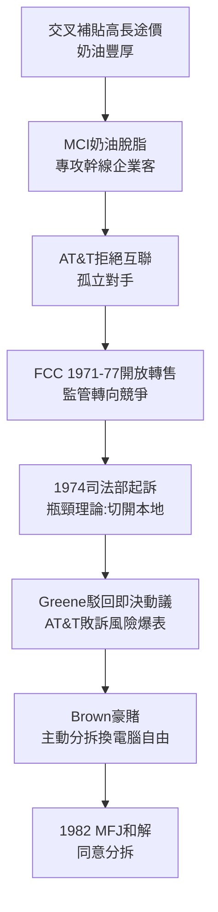

# 3.1 反托拉斯訴訟與 AT&T 的黃昏 (1974-1982)

> 1974 年 11 月 20 日，福特政府司法部起訴 AT&T，要求肢解這個擁有 100 萬員工、佔全美電話 85% 的巨獸。官司打了 8 年，AT&T 不是輸在法庭，而是輸在時代。

## 一、挑戰者：MCI 的游擊戰

故事主角不是司法部，而是一家小公司 MCI（Microwave Communications Inc.）。創辦人 Bill McGowan 看穿了 AT&T 交叉補貼的死穴：長途價格遠高於成本。MCI 專建繁忙幹線的微波線路（芝加哥—聖路易），只做企業大客戶，不管偏遠虧損線路——成本只有貝爾的一半。

AT&T 的反擊是拒絕互聯：MCI 用戶打不到貝爾本地用戶，形同孤島。MCI 遂於 1974 年另案起訴 AT&T（後獲 18 億美元賠償裁決，雖經上訴削減，但氣勢已成）。FCC 在 1971–1977 年間連續裁決開放專線與長途轉售，監管風向已變：**從保護壟斷轉向鼓勵競爭**。

司法部的訴狀邏輯直指結構：AT&T 以本地壟斷（瓶頸設施 bottleneck）補貼長途與設備，排擠競爭。解方只有一個——**把瓶頸（本地）與競爭性業務（長途＋設備）切開**。

## 二、Greene 法官與 Brown 的豪賭

承審法官 Harold Greene 駁回 AT&T 的即決駁回動議，意味案件必須進入實質審理——AT&T 敗訴風險陡增。時任董事長 Charles Brown（1979 上任）做出驚人決斷：**與其被法院切碎，不如主動談判分拆，換取進入電腦業的自由**。

Brown 的算盤：

- 電話成長已趨緩，電腦＋資訊才是未來；
- 1956 年禁入電腦令是緊箍咒，分拆和解可一併解除；
- 主動分拆可保留長途、貝爾實驗室、西方電氣，吐出本地公司；
- 長途＋資訊的「新 AT&T」將輕裝上陣。

1982 年 1 月 8 日，雙方達成和解（Modification of Final Judgment, MFJ），AT&T 同意分拆；8 月 Greene 法官批准。這是第三次「以結構換自由」——但這次，切下的是四肢，不是小指。

## 三、為什麼 AT&T 必敗？

1. **經濟學變了**：芝加哥學派與管制經濟學證明，長途與設備已非天然壟斷，只有本地迴路是瓶頸；
2. **技術變了**：微波、衛星、光纖使長途進入門檻大降，天然壟斷的技術基礎瓦解；
3. **政治變了**：雷根政府信奉解除管制（deregulation），連 AT&T 的老朋友軍方也不再堅決護盤（軍方已有自主通訊網）；
4. **對手變了**：MCI、Sprint 有華爾街撐腰，遊說能力不亞於貝爾。

百年壟斷的四大支柱（法律豁免、技術壁壘、政治默契、交叉補貼）同時崩塌。

## 因果鏈

> **前因**：第二章的交叉補貼高價（因）→ MCI 的套利空間（果）；Carterfone 互聯原則（因）→ MCI 主張接入權的法理基礎（果）；1956 年專利開放養大的資訊業（因）→ 「通訊電腦融合、必須拆分」論述（果）。
> **本節驅動後果**：1974 年起訴（因）→ Brown 以分拆換電腦自由的豪賭（果），直接決定下一節 1984 年分拆的具體形態——AT&T 保長途、棄本地；而「進入電腦業」的執念（果），則驅動下下節 NCR 併購的災難。**為了解開舊鐐銬，AT&T 親手戴上了新枷鎖**。
