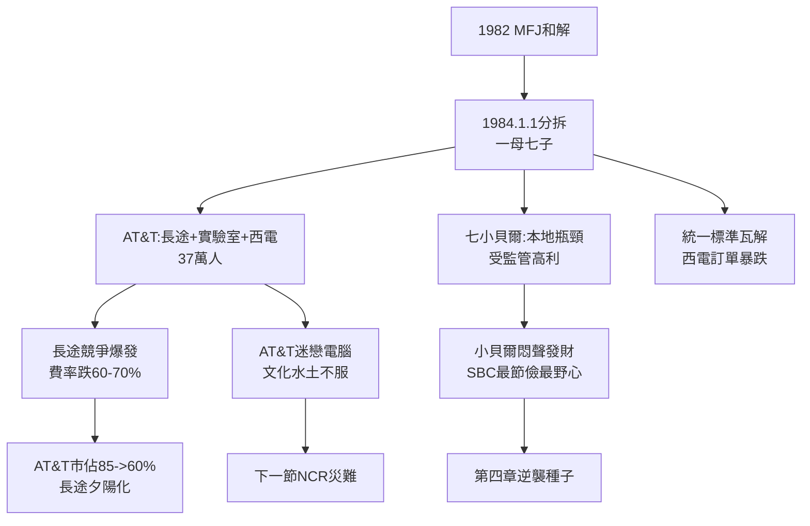

# 3.2 1984分拆與七小貝爾 (1984-1990)

> 1984 年 1 月 1 日，美國電話系統一分為八：AT&T 保住長途、實驗室與西方電氣，22 家本地貝爾公司重組為 7 家區域貝爾（Baby Bells）。這一天被稱為「電信大爆炸」，用戶拿起話筒，聽到的還是撥號音——帝國解體，竟悄無聲息。

## 一、分拆方案：MFJ 的手術刀

根據修正最終判決（MFJ）：

- **AT&T（長途公司）**：長途＋國際＋貝爾實驗室＋西方電氣＋新成立的 AT&T 電腦部門；約 37 萬員工，營收約 340 億美元；
- **七小貝爾（RBOCs）**：Ameritech、Bell Atlantic、BellSouth、NYNEX、Pacific Telesis、Southwestern Bell（SBC）、US West；各據一方，壟斷本地，禁止進入長途與設備製造（防止重演交叉補貼）；
- **本地接入費（access charge）**：長途公司向本地公司支付接續費，替代舊交叉補貼——MCI、Sprint 與 AT&T 同受此約，形式公平。

AT&T 一夜從 100 萬員工、1500 億資產的托拉斯，縮為純長途商。市佔率從 85% 起跌，MCI 與 Sprint 立即以低價搶攻。

## 二、分拆的意外後果

### 1. 長途價格崩盤，消費者狂歡

競爭使長途費率 1984–1995 年間下跌約 60–70%。美國消費者是分拆的最大贏家。AT&T 長途市佔十年內從 ~85% 跌至 ~60%。

### 2. 七小貝爾比媽媽更賺錢

被吐出的本地公司坐擁瓶頸資產（每一棟樓的銅線都歸它），受州監管保護，利潤穩定。華爾街很快發現：小貝爾的股價表現超越母公司。其中最不起眼的 **Southwestern Bell（總部聖安東尼奧，轄區德州一帶）** 在 Ed Whitacre 領導下最低調、最節儉，也最有野心——它正是第四章逆襲的主角。

### 3. 貝爾系統的離心力

統一標準瓦解：各小貝爾自購設備（不再只買西方電氣），西方電氣訂單暴跌；貝爾實驗室一分為二（AT&T 保留大部，本地部分劃給新成立的 Bellcore）。「One System」正式死亡。

## 三、AT&T 的迷失：長途夕陽

分拆後的 AT&T 管理層認定：話音長途是夕陽，電腦＋資訊才是朝陽。1980 年代 AT&T 大舉投入電腦（3B 系列、PC 6300）、押注 ISDN 與 OSI 標準，卻連連失手——電話公司文化（重可靠、慢決策）與電腦業（快迭代、容忍 bug）水土不服。長途本業則被 MCI 以「1-800-COLLECT」等行銷戰打得節節敗退。

MFJ 每三年覆議一次，小貝爾不斷遊說要求鬆綁進入長途；AT&T 則要求進入本地與有線電視。監管進入十年拉鋸，直到 1996 年電信法改寫規則。

## 因果鏈

> **前因**：Brown 以分拆換電腦自由的豪賭（因）→ 1984 年 AT&T 變純長途商（果）；瓶頸理論（因）→ 七子分 Guardian 本地（果）。
> **本節驅動後果**：分拆把「最賺錢的資產（本地瓶頸）」判給了七小貝爾（果），其中體質最佳的 SBC 將在下一章反向吞併母公司——**被吐出的孩子長大後吃掉了母親**；而 AT&T 死守「電腦夢」（果），直接驅動下一節 1991 年天價收購 NCR 的豪賭。分拆沒有殺死壟斷，只是把它切碎重組，等待下一次聚合。
