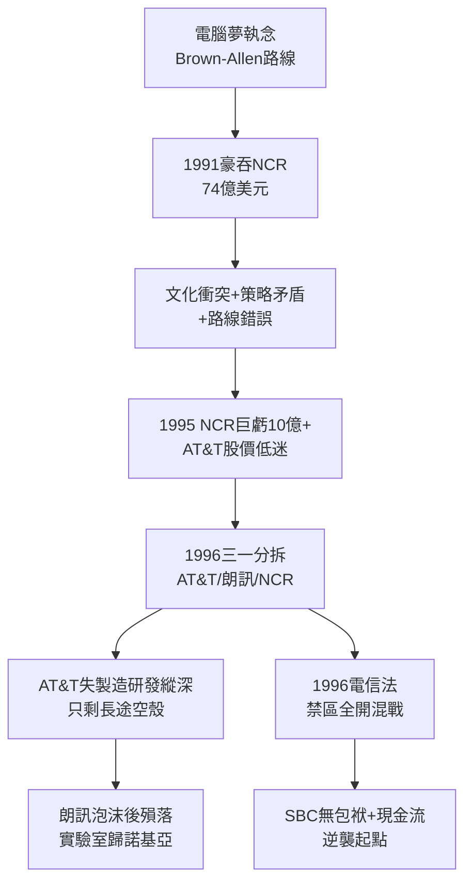

# 3.3 朗訊分拆與電腦業挫敗 (1991-1996)

> 1991 年，AT&T 以 74 億美元吞下 NCR，號稱「電話＋電腦＝資訊巨獸」；1996 年認賠分拆，連設備製造（朗訊）與電腦（NCR）一併吐出。五年豪賭，證明了一件事：脫下壟斷盔甲的 AT&T，在競爭市場寸步難行。

## 一、NCR：史上最貴的學費

董事長 Robert Allen 延續 Brown 的電腦夢：AT&T 有網路、NCR 有機器，結合成「端到端資訊方案」。1991 年以 74 億美元（當時美國史上最大 hostile 收購之一）強吞 NCR。

結果是災難教科書：

- **文化衝突**：貝爾的終身僱用官僚 vs. NCR 的現金機文化，人才大量流失；
- **策略矛盾**：NCR 的開放系統客戶（如銀行）視 AT&T 為電信對手，不敢下單；AT&T 長途客戶視 NCR 設備為綁售，兩面不討好；
- **時機錯誤**：正值 Wintel＋網際網路爆發，AT&T-NCR 的專有大型機路線被掃進歷史。

1995 年 NCR 虧損逾 10 億美元，AT&T 被迫認賠。連同電腦夢一起陪葬的，是 1984 年分拆時最看重的「進入資訊業自由」——自由到手，才發現沒有能力。

## 二、三一分拆（Trivestiture, 1996）

1995 年 9 月，Allen 宣布 AT&T 一分為三：

1. **AT&T（長途＋無線）**：保留品牌與長途、 cellular 業務；
2. **朗訊（Lucent Technologies）**：西方電氣＋貝爾實驗室大部，設備製造商，1996 年 IPO（當時史上最大 IPO 之一）；
3. **NCR**：電腦業務獨立，恢復原名。

加上此前 1994 年剝離的 CellNet 概念，分拆後的 AT&T 只剩長途＋行動雛形，營收腰斬。華爾街鼓掌（分拆綜效、股東價值），但 AT&T 從此失去製造與研發縱深——**貝爾實驗室的母體被掏空了**。朗訊帶走女王冠，AT&T 只剩王冠盒子。

諷刺的是，朗訊分拆即巔峰：受惠網路泡沫，股價一度飆升，2000 年後泡沫破裂、會計醜聞，2006 年被阿爾卡特併購（Alcatel-Lucent），貝爾實驗室幾經轉手，最終落入諾基亞手中。

## 三、1996 電信法：起跑槍再響

1996 年 2 月《電信法》（Telecom Act）廢除 MFJ 的長途/本地禁區：小貝爾可申請進入長途（14 點核准制），長途公司可進入本地，有線電視與電話互相准入。全美電信進入「人人可打人人地盤」的混戰。

AT&T 試圖以長途品牌杀入本地（如收購 TCI 有線計畫，見後），小貝爾則試圖杀入長途。混戰中，財務最乾淨、包袱最輕的 **SBC** 反而佔了上風——它沒有 AT&T 的電腦包袱，沒有朗訊泡沫，只有一塊塊穩定現金流的本地地盤，正好用來當併購貨幣。

## 因果鏈

> **前因**：1982 年以分拆換電腦自由（因）→ 管理層執念於證明分拆值得（果）→ NCR 豪賭（果）；統一標準瓦解後西電訂單暴跌（因）→ 設備部門變包袱（果）→ 朗訊分拆（果）。
> **本節驅動後果**：三一分拆把 AT&T 掏成「純長途品牌空殼」（果），市值與戰略縱深跌至百年谷底——這正是下一章 SBC 得以「小吃大」的必要條件；1996 年電信法拆除最後管制牆（果），為 SBC 連續併購打開法律之門。**AT&T 用十二年證明自己不會做電腦，用一紙分拆為掘墓人備好棺材與釘子**。
