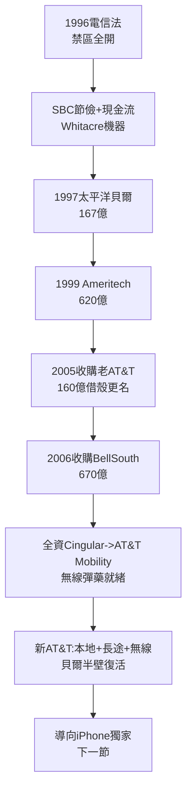

# 4.1 Whitacre 併購之路與重取 AT&T 之名 (1996-2006)

> 聖安東尼奧的牛仔吃掉了紐約的貴族。SBC 董事長 Ed Whitacre 用十年併購，把最小的小貝爾變成最大的電話公司，然後——搶走母親的名字。2005 年，SBC 收購 AT&T，卻宣布沿用「AT&T」之名。這不是收購，這是借屍還魂。

## 一、牛仔的併購機器

Ed Whitacre（1941–），德州人，行事如油田 wildcatter：低調、節儉、敢賭。1996 年電信法開門後，SBC 的連環併購如下：

- **1997：SBC 收購 Pacific Telesis（太平洋貝爾）**，約 167 億美元，拿下加州；
- **1998：SBC 收購 Southern New England Telecom**，補齊新英格蘭缺口；
- **1999：SBC 收購 Ameritech**，約 620 億美元，拿下中西部五州，一舉成最大本地商；
- **2005：SBC 收購 AT&T（長途本尊）**，約 160 億美元；
- **2006：新 AT&T 收購 BellSouth**，約 670 億美元，拿下東南九州＋Cingular 無線全權。

十年五吞，版圖從德州一隅擴為全美 22 州本地＋全國長途＋最大無線（Cingular）。併購貨幣是穩定的本地現金流＋節儉文化整合（每併一家即裁員、統購、砍福利，綜效驚人）。

為什麼是 SBC 勝出？七小貝爾中，US West 冒進買有線、BOC 們內鬥，只有 SBC 專注「本地＋無線」、財務保守、執行力強。1996 年電信法本意是促進競爭，結果卻孵化了新的巨獸——監管者始料未及。

## 二、2005：小吃大與品牌借殼

2005 年收購 AT&T 時，SBC 營收體量已超老 AT&T。Whitacre 堅持用「AT&T Inc.」為存續名、沿用藍色地球標誌，理由直白：「AT&T 在全球無人不曉，SBC 只有德州人知道。」NYSE 代碼沿用 T（源自 Telephone）。

法律上是 SBC 存續，品牌上是 AT&T 復活。老 AT&T 股東每股換 0.69 股新股，百年老店正式易主。媒體標題：「女兒吞了媽媽，還穿上媽媽的衣服。」

2006 年收購 BellSouth 更具戰略意義：全資收回 Cingular Wireless（原 SBC＋BellSouth 合資），改名 AT&T Mobility——為下一節的 iPhone 時代備好無線彈藥。若無 BellSouth，就無 Cingular；若無 Cingular，賈伯斯不會敲門。

## 三、重組的貝爾：新壟斷？

2006 年的新 AT&T 坐擁：全美最大本地網＋最大無線網＋全國長途骨幹。市佔與 1984 年前不可同日而語（無線與寬頻皆有強敵 Verizon、T-Mobile），但在固網本地仍具支配力。司法部附加條件批准 BellSouth 交易（光纖中立、頻譜承諾），未再拆分。

歷史的辯證法：1984 年用手術刀切碎的壟斷，2006 年用支票簿拼回了一半。Vail 的「One System」幽靈，在光纖與無線時代借屍還魂。

## 因果鏈

> **前因**：1984 年把本地瓶頸判給小貝爾（因）→ SBC 坐擁現金奶牛（果）；1996 年三一分拆掏空老 AT&T（因）→ 老 AT&T 淪為可吞併的品牌空殼（果）；1996 年電信法（因）→ 連環併購的法律許可（果）。
> **本節驅動後果**：SBC 拼回半壁貝爾並全資掌控無線（果），直接構成下一節的前提——沒有 Cingular 全權，AT&T 不敢與蘋果簽獨家對賭；同時，固網整合完成意味成長必須向外尋找（果），為下下節 DirecTV 與時代華納的內容豪賭埋下動機。**拼圖拼回一半，發現圖紙已經換了——話音不再值錢，內容與無線才是新大陸**。
