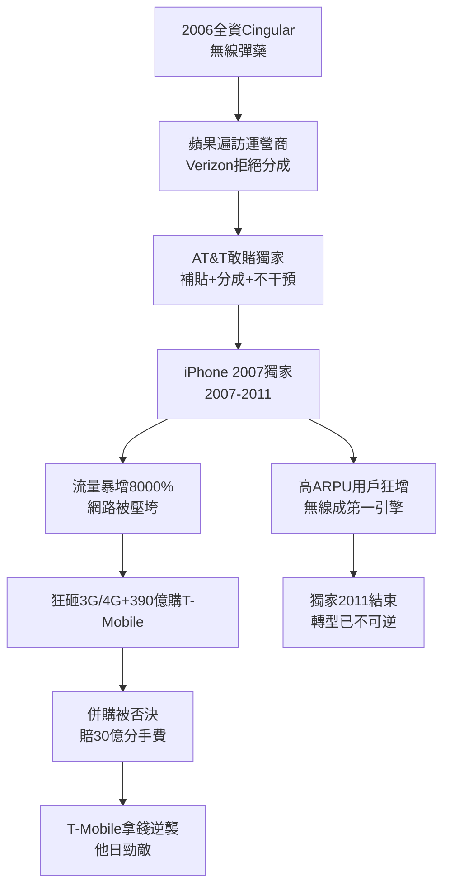

# 4.2 iPhone 獨家與行動網路重生 (2007-2013)

> 2007 年 6 月 29 日，賈伯斯舉起第一代 iPhone：「今天蘋果重新發明了電話。」台下沒人注意，手機角落的訊號格寫著「AT&T」。這場獨家合作拯救了 AT&T 的無線帝國，也差點壓垮它的網路。

## 一、賭局：為什麼是 AT&T？

2005–2006 年，賈伯斯帶著iPhone 原型遍訪美國運營商：Verizon 嫌蘋果要分成、要控制、不肯讓步；Sprint、T-Mobile 技術制式（CDMA）不合。唯有 Cingular（即將改名 AT&T Mobility）CEO Stan Sigman 敢賭：

- 接受蘋果**獨家＋營收分成＋不干預設計＋巨額補貼**（每支補貼約 400 美元）；
- 換取 5 年（實約 4 年，2007–2011）美國獨家銷售權；
- 賭注：智慧型手機將引爆數據需求，AT&T 的 GSM/UMTS 路線與蘋果合拍。

2007–2011 年，AT&T 賣出數千萬支 iPhone，新增用戶多數為高 ARPU（每用戶平均收入）的月租客，無線營收狂飆，一舉超越固話成為第一引擎。華爾街從此用「無線用戶淨增」評價 AT&T——百年電話公司，變成手機公司。

## 二、甜蜜的負擔：網路被壓垮

iPhone 的成功幾乎殺死 AT&T 的網路：數據流量 2007–2010 年暴增約 8000%，紐約、舊金山頻傳斷線，「AT&T 訊號差」成脫口秀笑柄。AT&T 被迫：

- 狂砸資本開支升級 3G（HSPA）、提前部署 4G LTE（2011）；
- 以 390 億美元豪購 T-Mobile USA（2011），意圖以頻譜解渴——遭司法部與 FCC 否決（反托拉斯），反賠 30 億美元分手費＋頻譜讓渡，堪稱偷雞蝕米；
- 推動 Wi-Fi 分流、femtocell 與限速政策。

諷刺的是，分手費中的頻譜與漫遊協議反而幫了 AT&T 一把；而 T-Mobile 經此一役獲得資金，幾年後在 John Legere 帶領下逆襲成「Un-carrier」，回頭痛打 AT&T——今日美國無線三足鼎立的恩怨，源頭在此。

2011 年獨家結束（Verizon 版 iPhone 上市），AT&T 無線神話褪色，但轉型已完成：數據取代話音， $ARPU_{數據} > ARPU_{話音}$ ，商業模式永久改寫。

## 三、U-verse 與固網的掙扎

同期固網以 U-verse（光纖到節點 FTTN＋VDSL）迎戰有線電視的 DOCSIS。U-verse 電視＋寬頻捆綁一度達千萬用戶，但 FTTN 頻寬天花板（初期下行僅 20–30Mbps）不敵 Cable，AT&T 在固網寬頻競賽中落居下風——這為第五章全面轉向 FTTH（光纖到戶）埋下伏筆。

## 因果鏈

> **前因**：BellSouth 收購換來 Cingular 全權（因）→ 敢與蘋果對賭的決策主體（果）；Verizon 的傲慢（因）→ AT&T 的機會（果），宛如 1877 年西聯拒購貝爾專利的翻版。
> **本節驅動後果**：iPhone 獨家把 AT&T 從固話公司變成無線公司（果），卻也暴露頻譜飢渴（果）→ 2011 年 T-Mobile 併購失敗（果）→ AT&T 得出「無線內生增長見頂，必須向內容要 ARPU」的結論，直接驅動下一節 DirecTV 與時代華納豪賭。**網路救了公司，公司卻怪網路不夠大——於是把目光投向好萊塢**。
