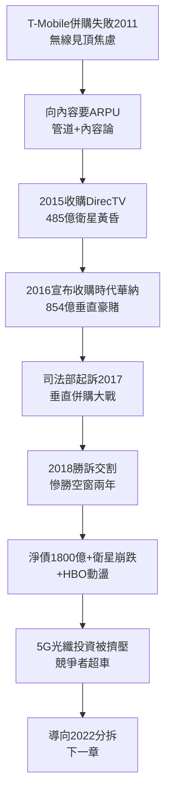

# 4.3 DirecTV 與時代華納豪賭 (2014-2018)

> 「內容為王，管道為后。」AT&T 董事長 Randall Stephenson 相信，只要同時擁有管道（無線＋光纖）與內容（好萊塢），就能向 Netflix 收過路費、向用戶收兩份錢。他為此押上 1800 億美元——AT&T 史上最大賭局，也是最貴的一課。

## 一、兩場豪購

- **2014–2015：收購 DirecTV，約 485 億美元**（含債約 671 億）。邏輯：全美最大衛星電視（約 2000 萬戶）＋ AT&T 無線捆綁，以「無限流量看 DirecTV 免流」對抗有線；協同效應估年省 25 億美元。
- **2016–2018：收購時代華納（Time Warner），約 854 億美元**（含債約 1087 億）。標的含 HBO、CNN、華納兄弟影業、DC、TNT/TBS。邏輯升級：從「管道＋分發」進化為「管道＋內容製作」，打造對抗 Netflix/Disney 的垂直巨獸；以定向廣告（Xandr）變現 HBO 數據。

兩案皆舉債收購。2018 年交割完成時，AT&T 淨負債逾 1800 億美元，成全球最大非金融借款人。股息貴族（連續 30 餘年增息）靠借錢維持派息，資產負債表緊繃如弦。

## 二、司法部阻擊戰：美國 v. AT&T

2017 年 11 月，川普政府司法部起訴阻止時代華納交易，主張垂直整合將抬高 Turner 頻道授權費、扼殺線上電視競爭。這是數十年來首起重大垂直併購訴訟。

2018 年 6 月，Leon 法官判決 AT&T 勝訴（司法部上訴，2019 年再敗）。AT&T 如願吞下時代華納，更名 WarnerMedia。但勝利是慘勝：兩年訴訟空窗期，Netflix 訂戶翻倍、Disney＋ 籌備就緒，WarnerMedia 整合停滯、人才流失（HBO 靈魂 Richard Plepler 去職）。

## 三、豪賭為什麼錯？

1. **協同證偽**：衛星電視正被串流取代，DirecTV 收購即巔峰，此後每年流失數百萬戶；HBO 的訂閱制基因與 AT&T 的電信 KPI 衝突，爆款《權力遊戲》後青黃不接；
2. **債務絞索**：$利息_{巨債} + 股息_{貴族包袱} > 自由現金流_{管道}$，5G 與光纖資本開支被擠壓，Verizon、T-Mobile 趁機超車；
3. **能力錯配**：電話公司不懂好萊塢（重複 NCR 教訓：電話文化 vs. 創意文化），Xandr 廣告夢被 Google/Facebook 碾壓；
4. **時機錯誤**：豪購完成之日，正是串流大戰白熱化、內容軍備競賽燒錢無底洞之時，AT&T 卻最缺錢。

Stephenson 的「管道＋內容」在理論上成立（Comcast＋NBCU 部分成功），但 AT&T 的執行（高價＋高債＋慢整合）把理論變成了悲劇。

## 因果鏈

> **前因**：iPhone 時代暴露的增長天花板與頻譜焦慮（因）→ 向內容尋找出路（果）；SBC 併購機器的成功慣性（因）→ 管理層迷信「大交易解千愁」（果）。
> **本節驅動後果**：1800 億巨債（果）直接剝奪 AT&T 在 5G 初期的投資能力（果），股價十年原地踏步、股息貴族地位動搖；DirecTV 與 WarnerMedia 的虧損（果）迫使繼任者 Stankey 斷臂求生——下一章的 WarnerMedia 分拆（2022）正是本節豪賭的清算時刻。**牛仔的槍，終於指向了自己**。
