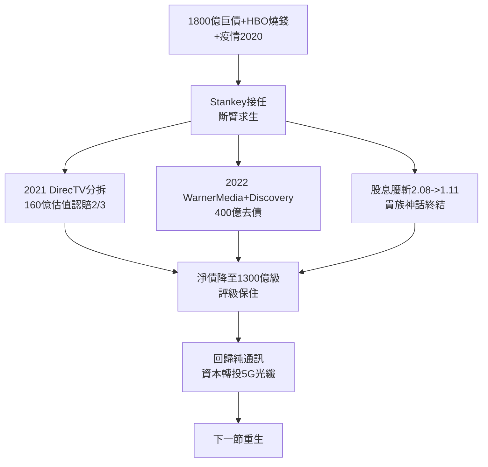

# 5.1 WarnerMedia 分拆與去槓桿 (2018-2022)

> 2022 年 4 月 11 日，WarnerMedia 與 Discovery 合併為 Warner Bros. Discovery（WBD），AT&T 股東拿走 71% 股權，AT&T 獲得約 400 億美元去債。這一天，AT&T 親手拆掉了四年前親手搭起的帝國——美國企業史上最昂貴的 U 轉之一。

## 一、Stankey 的手術刀

2020 年 John Stankey 接替 Stephenson。面對 1800 億淨債＋疫情衝擊＋HBO Max 燒錢（與 Netflix/Disney＋ 對燒），Stankey 三刀斷臂：

1. **2021：DirecTV 分拆**，作價 78 億美元出售 30% 給 TPG（整體估值僅 160 億，不及收購價 1/3），保留 70% 股權但不再併表——承認衛星豪賭失敗；
2. **2022：WarnerMedia 分拆合併 Discovery**，交易結構為免稅分拆（Reverse Morris Trust），AT&T 獲約 400 億現金＋債務轉移，大幅去槓桿；
3. **股息腰斬**：年股息從約 2.08 美元砍至約 1.11 美元，終結 30 餘年貴族神話，但每年省下約 60–80 億美元現金，轉投光纖與 5G。

華爾街以暴跌回應（分拆後股價一度跌破 15 美元），散戶罵聲震天。但資產負債表從加護病房回到普通病房：淨債 2022 年底降至約 1300 億美元上下區間，自由現金流重獲喘息。

## 二、為什麼必須拆？

算一筆簡帳：設 $D$ 為淨債，$E$ 為 EBITDA，槓桿率 $L = D/E$。2019 年 AT&T 的 $L$ 約 2.5–3 倍，而 5G 頻譜（C-band 拍賣 AT&T 豪擲約 270 億美元）＋光纖（年資本開支 200 億美元級）需要持續失血。HBO Max 每年再燒數十億，$L$ 奔向 4 倍，評級面臨垃圾級懸崖。拆內容，是保評級、保管道的唯一解。

更深層是戰略認錯：電信與內容的協同從未實現——Xandr 廣告 2021 年賤賣給微軟；HBO Max 用戶增長不及預期；DirecTV 失血不止。Stephenson 的垂直帝國，在財務上不可持續，在營運上無協同。

## 三、清算與傳承

分拆完成後，AT&T 回到 1996 年三一分拆後的原點——**純通訊公司**，只是多了無線與寬頻。兜了 30 年大圈（長途→電腦→內容→通訊），起點即終點。

但這次收縮與 1984、1996 不同：前兩次是政府拿刀切，這次是自己拿刀切。AT&T 終於學會 Vail 在 1913 年的智慧——**讓步是最高級的進攻**，只是這次讓給的是市場，不是政府。

## 因果鏈

> **前因**：上一節 854 億＋485 億豪賭舉債（因）→ 1800 億巨債與評級懸崖（果）；司法空窗期錯失串流先機（因）→ WarnerMedia 估值追不上燒錢速度（果）→ 非拆不可。
> **本節驅動後果**：分拆去債（果）換回投資管道的彈藥（果），直接啟動下一節的 5G mid-band 與光纖千萬戶計畫；股息腰斬（果）則洗掉一批收息散戶、換來一批成長型機構股東，股東結構重塑。**AT&T 用 600 億學費證明：電話公司演不好好萊塢——然後轉身，把聚光燈打回光纖**。
