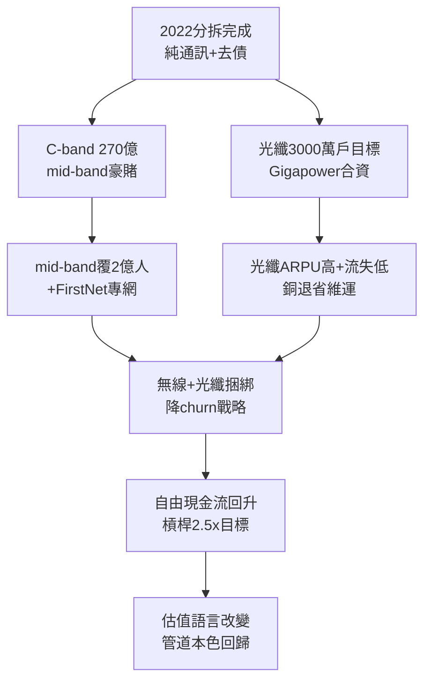

# 5.2 專注通訊本業與 5G 光纖 (2022-2026)

> 拆完好萊塢之後，AT&T 只剩兩條路：把無線做厚，把光纖做深。2022 年後的口號變了——不再是「內容為王」，而是「Best Connectivity」（最佳連接）。帝國瘦了，肌肉卻回來了。

## 一、雙引擎：5G mid-band＋FTTH

### 1. 無線：C-band 豪賭的第二春

2021 年 C-band 頻譜拍賣，AT&T 豪擲約 270 億美元（含清理費），拿下 80MHz 左右 mid-band——這是 5G 體驗的分水嶺（覆蓋＋速率兼得，迥異於毫米波的花瓶與低頻的龜速）。2022–2024 年快速部署，AT&T 宣稱 mid-band 覆蓋逾 2 億人口（與 Verizon 競逐）。FirstNet（美國第一 responder 專網，AT&T 2017 年奪標、25 年合約）更提供穩定的政府現金流與 20MHz 低頻品質資產。

無線策略轉向務實：不再追求激進價格戰（讓給 T-Mobile），而以**捆綁（bundle）**取勝——無線＋光纖同購折扣，降低流失率（churn）。數據證明捆綁用戶流失率顯著低於單業務用戶， $churn_{bundle} < churn_{single}$ ，遂成全公司 KPI。

### 2. 固網：光纖到戶（FTTH）的豪賭

AT&T 宣布局建 3000 萬戶以上光纖可及（fiber passings，含自建＋合資 Gigapower），年增數百萬戶，是美國最大光纖建設商。邏輯：

- 光纖 ARPU 高於銅線＋U-verse，且維護成本低、流失率低；
- 銅線退網（copper retirement）節省維運巨款；
- 光纖＋無線捆綁是對抗 Cable（Comcast/Charter）與 T-Mobile FWA（固定無線）的唯一壁壘。

2023–2024 年光纖新增用戶連季數十萬，成為固網成長引擎。華爾街開始用「光纖滲透率」而非「電視戶數」評價 AT&T——估值語言的改變，標誌轉型被承認。

## 二、財務紀律：從貴族到工人

Stankey 立下三規：資本開支聚焦連接（年約 210–220 億美元級）、自由現金流優先還債（槓桿目標 $L \to 2.5\times$ ）、股息維持不增（保住現金）。2023–2025 年自由現金流回升至 160–200 億美元級，淨債穩步下降。股價從 2022 年谷底緩步修復，雖遠不及科技股，但波動率與殖利率回歸公用事業本色。

未竟之業：傳統語音與 DirecTV 殘股仍在失血；企業固網（legacy wireline）受 SD-WAN 侵蝕；T-Mobile 在無線淨增上仍壓制。但方向已無爭議——**做美國最好的管道，不做美國最爛的片廠**。

## 因果鏈

> **前因**：WarnerMedia 分拆省下的現金與股息（因）→ C-band 與光纖的彈藥（果）；DirecTV 失血教訓（因）→ 不再迷戀視頻分發、轉投捆綁（果）。
> **本節驅動後果**：雙引擎初見成效（果）→ AT&T 重獲「可投資的公用事業」身份（果），為下一節的歷史評價提供當代註腳——百年輪迴後，Vail 的「普及服務」在光纖時代以新面貌復活（偏遠補貼、FirstNet、普遍連接）。**從銅線到光纖，從話音到比特，變的是介質，不變的是那句 One System**。
