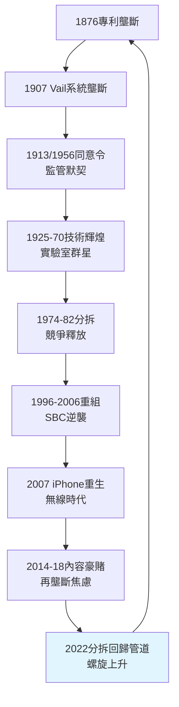

# 5.3 百年 AT&T 的歷史評價 (1876-2026)

> 150 年間，AT&T 被拆了三次（1913 自切、1984 被切、1996 自切），又拼回兩次（2005–2006、內容豪賭未遂）。它發明了未來兩次（電晶體、Unix），錯過兩次（電腦、串流）。如何評價這樣一家公司？——它是美國監管資本主義的最佳標本。

## 一、三個 AT&T，三種美國

1. **貝爾的 AT&T（1876–1984）：壟斷即進步**。在天然壟斷＋強監管的默契下，以全民話費資助了人類最偉大的工業實驗室。代價是壓抑競爭與創新多樣性，但產出（橫貫大陸、電晶體、資訊論）足以載入文明史。
2. **分拆的 AT&T（1984–2005）：競爭即正義**。長途費率跌七成、MCI/Sprint/朗訊/矽谷百花齊放，證明拆分釋放了活力。但代價是貝爾實驗室解體、美國電信失去統一標準，長途淪為薄利紅海。
3. **新 AT&T（2005–）：聚合即生存**。SBC 拼回半壁，以無線＋光纖＋（一度）內容求生。證明在資本密集的連接業，規模仍是王道；但內容豪賭證明，規模跨界即災難。

## 二、互相驅動的百年迴圈

全書的因果主線可收束為一個迴圈：

$\text{專利壟斷} \to \text{系統壟斷} \to \text{監管默契} \to \text{技術輝煌} \to \text{禁令束縛} \to \text{分拆} \to \text{重組} \to \text{再壟斷焦慮} \to \cdots$

每一次壟斷都孕育下一次分拆的種子（高價→套利→訴訟），每一次分拆都孕育下一次重組的種子（碎片→綜效→併購）。AT&T 不是在直線前進，而是在螺旋上升：同樣的劇本（同意令、豪賭、斷臂），演員從銅線換成光纖，從話音換成比特。

## 三、功過簿

**功**：

- 把電話從奢侈品變成全民基礎設施（Universal Service 的兌現）；
- 以壟斷利潤資助貝爾實驗室，間接催生數位時代（電晶體、資訊論、Unix、C、蜂窩、雷射）；
- 建成全球最可靠的長途與無線骨幹，戰時國之重器，平時民之日用。

**過**：

- 以拒絕互聯、專利 wall、金融絞殺壓制競爭半世紀；
- 1956 年後坐擁金山而不自知，NCR、DirecTV、時代華納三場豪賭燒掉逾千億股東價值；
- 壟斷文化（官僚、傲慢、慢決策）屢屢錯失典範轉移（電腦、網際網路、串流）。

一言以蔽之：**AT&T 是最好的壟斷者，也是最差的競爭者**。給它壟斷，它回報人類以星辰大海；把它扔進競爭，它連自己的名字都差點保不住——若非 SBC 借殼，AT&T 三字今日或已進博物館。

## 因果鏈

> **前因**：全書十四節的因果總和——專利的廣度註定懸崖，懸崖註定系統壟斷，壟斷註定監管，監管註定輝煌與束縛，束縛註定分拆，分拆註定重組，重組註定新的過度。
> **本節驅動後果**：歷史評價本身成為未來的因——AT&T 的故事告訴後來者（無論是今日的平台巨頭，還是明日的 AI 基礎設施）：壟斷與創新的兌換率從來不固定，監管與市場的鐘擺永不停歇。讀懂 AT&T，就讀懂了美國一個半世紀的政商契約：**社會容忍巨獸，巨獸必須回報星辰；當巨獸只回報股息與豪賭，刀就會落下——無論刀在政府手中，還是在自己手中**。
