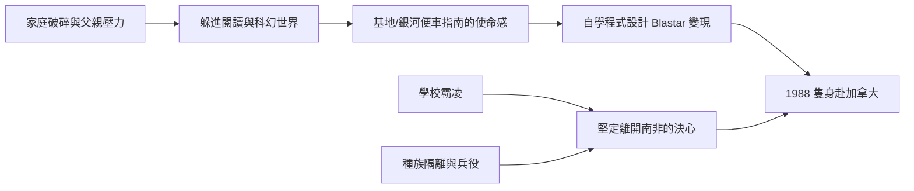

# 1.1 南非歲月：書蟲、科幻與逃離（1971–1989）

## 童年與家庭

伊隆·馬斯克於 1971 年 6 月 28 日出生於南非普利托利亞。父親埃羅爾·馬斯克（Errol Musk）是工程師，母親梅耶·馬斯克（Maye Musk）是模特兒與營養師。他有一個弟弟金巴爾（Kimbal）與一個妹妹托斯卡（Tosca）。

馬斯克的童年並不快樂。父母在他年幼時離異，他選擇跟隨父親生活，後來他多次形容父親嚴苛、情緒化，這段關係成為他終生的陰影。在學校裡，他是體格瘦弱、社交笨拙的書蟲，長期遭受霸凌，甚至曾被打到住院。

## 閱讀、科幻與「使命感的種子」

無處可去的馬斯克把大量時間投入閱讀。他自稱小學時讀完了整座圖書館，一天可以讀十小時。影響他最深的兩部作品：

- **《銀河便車指南》（The Hitchhiker's Guide to the Galaxy）**：教會他「提出正確的問題」比答案更重要——這成為他日後「讓人類成為多行星物種」的思考起點。
- **《基地》（Foundation）系列**：艾西莫夫「以科技延長文明壽命」的宏大敘事，直接塑造了他「擴展人類意識邊界」的使命感。

十歲左右他拿到第一台電腦 Commodore VIC-20，自學程式設計，十二歲時寫出一款太空射擊遊戲 **Blastar**，以約 500 美元賣給雜誌社——這是他人生第一筆「技術變現」。

## 為什麼要離開南非

1980 年代的南非仍處於種族隔離制度尾聲，兵役義務陰影籠罩。馬斯克認定：

1. 不想服兵役參與鎮壓；
2. 科技與商業機會在美國；
3. 需要徹底擺脫父親。

他發現母親是加拿大公民，依血统原則他可以申請加拿大國籍。1988 年，十七歲的馬斯克瞞著父親申請護照，隻身飛往加拿大——幾個月後他甚至沒等高中文憑正式發下就出發了。

## 因果鏈

- **前因**：家庭破碎、校園霸凌與南非的政治環境，迫使馬斯克向內退縮，用閱讀與程式設計建造自己的世界。
- **後果**：科幻小說灌輸的「文明存續」使命感 + 程式設計的早期成功，成為他日後一切事業的精神底層；而「逃離南非」則直接導致他進入加拿大，開啟北美的求學與創業之路。
