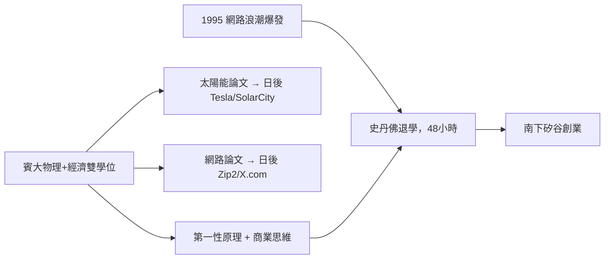

# 1.3 賓州大學與矽谷前夕（1992–1995）

## 物理與經濟的雙學位

1992 年馬斯克進入**賓州大學**，1995 年先後取得**物理學士**與**華頓商學院經濟學士**雙學位。這個組合並非偶然：

- **物理**教會他「從第一性原理（First Principles）思考」——把問題拆解到物理本質，而非類比既有做法。
- **經濟**教會他理解資本、市場與激勵結構。

第一性原理思維日後成為 SpaceX 降低火箭成本、Tesla 重新定義電池價格的核心方法論。

## 兩篇方向性的論文

在賓大，馬斯克寫了兩篇預言式的論文：

1. **《太陽能發電社會的未來》**：預判太陽能 + 電池儲能將成為主要能源。
2. **關於「文獻電子掃描與資訊高速公路」**：預判網路將徹底重構資訊流通。

兩篇論文分別對應他日後的 Tesla/SolarCity 與網路創業——他的人生方向在大學時期已經寫好草稿。

## 史丹佛的 48 小時

1995 年，馬斯克前往**史丹佛大學**攻讀應用物理博士，計畫研究電容與儲能。但入學兩天後他就退學了：1995 年的網路浪潮正在爆發，他判斷「坐在教室裡看著網路革命發生，比錯過它更可怕」。

## 因果鏈

- **前因**：科幻使命感需要具體的知識工具，物理與經濟的雙學位提供了「看懂未來」的框架。
- **後果**：兩篇論文預埋了 Tesla 與網路創業兩條路線；而退學的衝動決定，直接把他推進 1995 年的矽谷——下一章的 Zip2 由此展開。馬斯克人生的「知識準備期」就此結束，正式進入「實戰期」。
