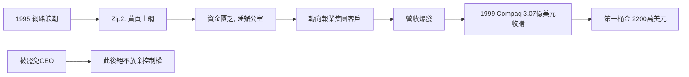

# 2.1 Zip2：第一次創業（1995–1999）

## 從黃頁到網路地圖

1995 年，馬斯克與弟弟金巴爾在加州帕羅奧圖創立 **Global Link Information Network**（後改名 **Zip2**）。最初的構想是：幫報紙把黃頁分類廣告搬到網路上，並結合地圖與導航。

- 資金極度匱乏：兄弟倆租下辦公室後就睡在裡面，去 YMCA 洗澡；只有一台電腦，白天馬斯克寫程式、金巴爾出去跑業務，晚上網站才上線。
- 馬斯克親自寫了整個後端（包括在 Unix 上處理地圖資料），展現了「創辦人即首席工程師」的模式。

## 抓住報紙的恐慌

真正的轉機來自策略調整：與其一家一家找小商家，不如直接賣給**報業集團**。1990 年代末，報紙被網路嚇壞了，急著買「上網方案」。《芝加哥論壇報》等大客戶陸續簽約，Zip2 快速擴張。

1999 年 2 月，康柏電腦（Compaq）以約 **3.07 億美元現金**收購 Zip2，馬斯克個人分得約 **2,200 萬美元**。

## 內鬥的教訓

Zip2 期間馬斯克被投資人罷免 CEO 職位、降為技術主管——這是他第一次被自己創立的公司「逐出權力核心」。這個屈辱經驗讓他此後在公司治理上極度強硬：絕不再讓董事會有機會把他踢出去。

## 因果鏈

- **前因**：賓大的網路論文與 1995 年退學，直接催生 Zip2；Zip2 又被投資人結構反噬（失去 CEO）。
- **後果**：2,200 萬美元是下一場豪賭的本金；「被罷免」的創傷則塑造了他日後在 Tesla、SpaceX、Twitter 強化控制權（超級投票權、董事會弱化）的行為模式。
