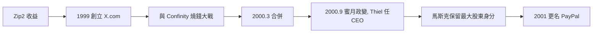

# 2.2 X.com 與線上金融實驗（1999–2000）

## 「超級銀行」的野心

1999 年 3 月，馬斯克投入約 1,200 萬美元個人資金（Zip2 收益的一半以上），創立 **X.com**——目標是打造一家沒有分行的「超級銀行」：帳戶、轉帳、投資全部線上完成。

他的邏輯是：金融業的資訊本質上就是資料，而網路處理資料的成本趨近於零——傳統銀行的實體結構終將被繞過。這個判斷在當時極為激進。

## PayPal 的誕生與合併

X.com 上線後，競爭對手 **Confinity**（Max Levchin、Peter Thiel 創立）憑藉一個小功能急速成長：用 Palm Pilot 紅外線互傳錢，後來轉向 **email 匯款**，產品名稱就叫 **PayPal**。

雙方燒錢大戰到 2000 年 3 月，理性收場：**X.com 與 Confinity 合併**。馬斯克任合併後公司的最大股東與 CEO。

## 政變與出局

合併後內部技術路線分裂（Unix vs Windows）。2000 年 9 月，馬斯克赴澳洲度蜜月途中，董事會發動政變，由 Peter Thiel 取代他出任 CEO。馬斯克再次被自己創立的公司踢出權力核心——但他選擇了**留下來當最大股東**，而不是賣股走人。

2001 年公司更名為 **PayPal**。

## 因果鏈

- **前因**：Zip2 的第一桶金 + 對「金融即資料」的第一性判斷，驅動他二度創業；與 Confinity 的同質競爭促成合併。
- **後果**：第二次被罷免的屈辱 + 保留最大股東的決定，使他在 2002 年 PayPal 出售時獲得約 **1.8 億美元**——這筆錢正是 SpaceX 與 Tesla 的全部燃料。沒有 X.com 的政變，就沒有 2002 年之後的火箭豪賭。
