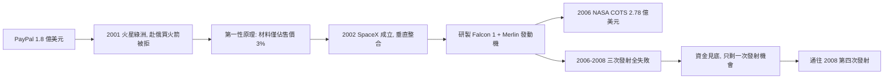

# 3.1 SpaceX 創立與獵鷹1（2002–2006）

## 火星綠洲：從買火箭到自己造

2001 年，剛套現的馬斯克提出一個近乎天真的計畫「火星綠洲」（Mars Oasis）：把小型溫室送上火星，拍攝植物在火星土壤中生長的照片，以此激發公眾對太空的熱情。他帶著行李箱的現金跑到俄羅斯，想買翻新的洲際飛彈 Dnepr 作為運載工具。

俄方開價一次比一次高（從 800 萬美元漲到 2,100 萬美元一枚），談判中還嘲笑他。回程飛機上，他算了一筆第一性原理帳：

> 火箭的材料成本（鋁合金、鈦、銅、燃料）僅佔售價的約 $3\%$ ，即 $C_{material} \approx 0.03 \times C_{price}$ 。剩餘 97% 是低產量、層層外包與壟斷利潤——自己造，成本可降一個數量級。

2002 年 3 月，**Space Exploration Technologies（SpaceX）** 在加州霍桑成立，目標不是做一次發射，而是把每公斤入軌成本降低十倍，最終殖民火星。

## 獵鷹1：小火箭、大賭注

SpaceX 第一個產品是兩級小型火箭 **Falcon 1**，使用自研的 Merlin 發動機。團隊多半是二十多歲的年輕工程師，實行高度垂直整合：發動機、箭體、航電、軟體全部自製。

2006 年 NASA 推出 COTS（商業軌道運輸服務）計畫，SpaceX 拿到 2.78 億美元的示範合約——這是早期唯一的外部輸血。但在此之前，SpaceX 靠的幾乎全是馬斯克的 1 億美元。

三次試射（2006、2007、2008 年 8 月）全部失敗：燃料洩漏、級間分離碰撞、第一級殘留推力撞擊第二級。每一次失敗都燒掉上千萬美元與一年時間。

## 因果鏈

- **前因**：PayPal 資金提供了「輸得起」的本錢；俄羅斯買火箭受辱提供了「必須自己造」的決心；第一性原理提供了「造得更便宜」的理論依據。
- **後果**：獵鷹1 的三次失敗把 SpaceX 推到懸崖邊，直接引爆第 3.3 節的 2008 生死關頭；但自研 Merlin 發動機與垂直整合團隊的積累，卻成為日後獵鷹9 可回收革命的技術母體。失敗本身就是學費。
