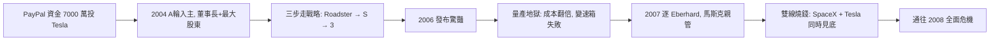

# 3.2 Tesla 入主與 Roadster（2004–2008）

## 不是創辦人，卻成為靈魂

Tesla 由 Martin Eberhard 與 Marc Tarpenning 於 2003 年創立，原型是把筆電電池（18650 鋰電池）塞進 Lotus 跑車車架。2004 年 A 輪融資時，馬斯克投資 630 萬美元，成為董事長與最大股東，條件是對技術路線有一票否決權。

他的判斷與眾不同：別人把電動車做成「環保妥協車」（慢、醜、貴），他堅持第一步必須是 **高性能跑車**——用 Roadster 證明電動車可以比油車更快更帥，再用賺到的錢做平價車。這就是後來的「858 秒...不，是三步走祕密計畫」：

1. Roadster（高價跑車）→ 證明可行；
2. Model S（豪華轎車）→ 擴大規模；
3. Model 3（平價車）→ 普及電動車。

## Roadster 難產：碳纖維地獄

2006 年 Roadster 發布驚豔全場，但量產是災難：

- Lotus 車架改裝幅度超過 90%，等於重新設計；
- 變速箱兩度推倒重來；
- 成本從預估 6.5 萬美元飆到超過 12 萬美元，每賣一輛虧一輛；
- 2007 年 Eberhard 被逐出 CEO，馬斯克親自接管。

馬斯克把 SpaceX 的工程方法搬進 Tesla：親自睡工廠、逐顆螺絲問成本、砍掉外包。他與 Eberhard 的決裂，也重演了 Zip2/X.com 的權力劇本——這次他是勝利者。

## 雙線燒錢

到 2007 年底，馬斯克同時在燒兩家公司的錢：SpaceX 三連敗，Tesla Roadster 難產。外界看來，這是同時在兩個最燒錢的行業（航太＋汽車）自殺。底特律嘲笑他，加州媒體稱他為騙子。

## 因果鏈

- **前因**：PayPal 資金讓他有能力同時下注火箭與電動車；SpaceX 的垂直整合經驗被移植到 Tesla，形成親力親為的工程獨裁。
- **後果**：Roadster 難產與雙線燒錢，直接把他推入 2008 年「兩家公司同時死線」的絕境；但三步走戰略與電池路線（18650 → 日後 Gigafactory）的確立，則為第 4 章 Model S/3 的普及鋪好路。沒有 2007 年的獨裁接管，就沒有後來的 Tesla。
