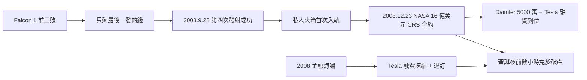

# 3.3 2008 危機與絕地反彈（2008）

## 聖誕夜前的一天：三重死亡線

2008 年是馬斯克一生最黑暗的一年，多重危機疊加：

- **金融海嘯**：Tesla 融資凍結，訂金車主開始退訂；
- **SpaceX**：前三次發射失敗，只剩最後一枚 Falcon 1 的錢；
- **Tesla**：Roadster 仍無法穩定交付，公司帳上只剩幾天現金；
- **個人**：離婚（與 Justine）、豪宅抵押、靠朋友借錢付房租。

12 月初，Tesla 帳面現金僅夠支撐到聖誕節。馬斯克同時談判三件事：Tesla 的過橋貸款、戴姆勒（Daimler）對 Tesla 的 5,000 萬美元投資、SpaceX 的 NASA 合約。

## 第四次發射：28 September 2008

2008 年 9 月 28 日，Falcon 1 第四次發射。在太平洋瓜加林環礁，火箭升空 9 分 30 秒後，第一級與第二級正常分離，假酬載順利入軌——**人類史上第一枚私人研發的液體燃料火箭入軌**。

僅僅三個月後，2008 年 12 月 23 日，NASA 宣布授予 SpaceX **16 億美元的國際太空站補給合約（CRS）**。這紙合約救了 SpaceX，也間接救了 Tesla——因為它證明馬斯克不是騙子，戴姆勒的投資與 Tesla 新一輪融資隨即到位。聖誕夜，Tesla 發薪日的幾小時前，資金到帳，公司免於破產。

馬斯克後來說：「2008 年，我的靈魂像是被放在鐵砧上反覆捶打。」

## 因果鏈

- **前因**：PayPal 資金燒盡＋前三次失敗＋Roadster 難產＋金融海嘯，四重槓桿把兩家公司同時推到懸崖；正是「只剩一發」的絕境，迫使團隊把所有教訓壓進第四次發射。
- **後果**：第四發成功 → NASA 16 億美元合約 → 信任背書 → Tesla 續命。這是全書最大的因果轉折：**失敗發射與 2008 危機，反向兌換成 NASA 的國家級信用**。沒有 2008 年 9 月 28 日，就沒有第 4 章的獵鷹9 與 Model S。絕境，是下一輪擴張的起點。
