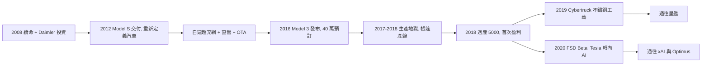

# 4.2 Model S 與 Model 3（2012–2020）

## Model S：證明電動車可以是最好的車

2012 年 **Model S** 交付，續航超過 400 公里，0–100 km/h 加速 4 秒級，並以中控大螢幕＋OTA（空中升級）重新定義汽車。它拿下《Motor Trend》年度風雲車，也是第一款在安全、性能、續航同時超越油車的電動車。

關鍵是商業模式：直營店＋自建超充網（Supercharger），繞過經銷商體系。傳統車廠嘲笑，車主卻排隊。

## Model 3：量產地獄

三步走的最後一步是 2016 年發布的 **Model 3**（3.5 萬美元起）。預訂一週超過 40 萬輛，訂金就收了 4 億美元——但產能跟不上。

2017–2018 年 Tesla 陷入「生產地獄」： Fremont 工廠的高度自動化產線頻頻卡關，馬斯克睡在工廠地板上，親自改寫機器人程式，甚至在停車場搭起帳篷式產線（Tent）。一度每週燒錢上億美元，距離破產只剩幾週。

2018 年中 Model 3 週產終於突破 5,000 輛，Tesla 首次連續兩季盈利。電動車從玩具變成主流。

期間還有插曲：2018 年馬斯克發推「考慮以 420 美元私有化 Tesla」，遭 SEC 起訴，被迫卸下董事長職務並罰款 2,000 萬美元——強人治理第一次付出法律代價。

## Cybertruck 與 FSD 的伏筆

2019 年 **Cybertruck** 發布（不鏽鋼稜角造型＋防彈玻璃現場碎裂的名場面），2020 年 **FSD Beta** 開始推送。這兩件事表面是鬧劇，實則埋下第 5 章的種子：Cybertruck 驗證不鏽鋼車身工藝（直接移植到星艦），FSD 則把 Tesla 從車廠推向 AI 公司。

## 因果鏈

- **前因**：Roadster 證明高性能可行＋2008 續命＋NASA 背書帶來的融資能力，讓 Model S 得以誕生；Model S 的利潤與品牌又支撐了 Model 3 的豪賭。
- **後果**：Model 3 量產成功把電池成本打下來，直接催生 Gigafactory 擴張（4.3）；而 Cybertruck 的不鏽鋼與 FSD 的神經網路，則分別引發第 5 章的星艦材料路線與 xAI/Optimus 機器人戰略。電動車普及，是 AI 與機器人的前傳。
