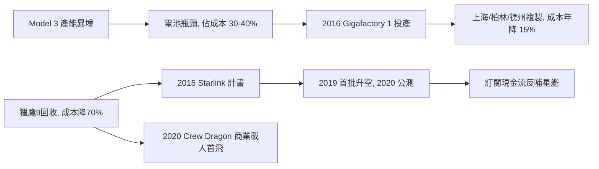

# 4.3 Gigafactory 與 Starlink（2014–2020）

## Gigafactory：把電池變成大宗商品

電動車真正的成本不在車殼，而在電池（約佔整車 $30\%$–$40\%$）。馬斯克與 Panasonic 合資，在內華達沙漠興建 **Gigafactory 1**（2016 投產），目標是把全球鋰電池產量翻倍，用規模把每 kWh 成本 $C_{kWh}$ 每年壓低約 $15\%$。

後續上海超級工廠（2019 年動工、11 個月投產）、柏林與德州工廠複製同一模式：廠房本身就是產品，用「建廠速度」碾壓對手。上海廠讓 Tesla 在中美貿易摩擦與疫情中依然維持產能，也讓中國電動車產業鏈整體加速。

## Starlink：用火箭養衛星，用衛星養火星

2015 年 SpaceX 提出 **Starlink**：發射 12,000 顆（後增至 42,000 顆）低軌衛星，提供全球衛星網際網路。邏輯閉環極為漂亮：

- 獵鷹9 可回收 → 發射成本大降 → 發自己的衛星最划算；
- Starlink 訂閱收入（高頻現金流）→ 反哺星艦研發（低頻大投入）。

2019 年首批 60 顆升空，2020 年開始公測。到 2020 年底在軌超過 900 顆，成為史上最大衛星群。

## 龍飛船載人：2020 的加冕

2020 年 5 月 30 日，Crew Dragon 載兩名 NASA 太空人升空，對接國際太空站——**人類商業載人首飛**，美國自 2011 年太空梭退役後首次本土載人發射。SpaceX 從瀕死新創，正式成為美國太空主力。

同年 Tesla 加入 S&P 500，馬斯克身家首次衝上世界首富。

## 因果鏈

- **前因**：獵鷹9 回收壓低發射成本，才有 Starlink 的經濟可行性；Model 3 爆單暴露電池瓶頸，才有 Gigafactory 的規模豪賭。兩者都是「量產倒逼基建」。
- **後果**：Gigafactory 保證了 Tesla 的利潤與產能，支撐其市值登頂；Starlink 提供了通往星艦的現金流，龍飛船載人則拿下 NASA 的政治信任。三者合力，把馬斯克從創業家推上「國家級基礎設施提供者」，直接開啟第 5 章星艦、X、xAI 的帝國擴張。
