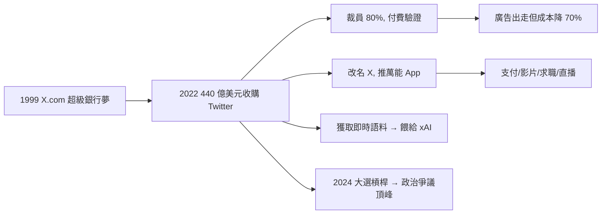

# 5.2 收購 Twitter 與 X 改造（2022–）

## 440 億美元的衝動與執念

2022 年 4 月，馬斯克以約 **440 億美元**收購 Twitter（後改名 X）。表面導火線是「言論自由」：他不滿平台的審查機制，發起收購後一度反悔，經法院強制執行才完成。

深層動機有三：

1. **X.com 未竟之夢**：1999 年的超級銀行構想從未實現，Twitter 的 2 億日活用戶是現成的支付＋社交入口；
2. **話語權**：擁有平台就擁有敘事權，可直接對抗媒體與監管；
3. **數據**：LLM 時代，真人即時語料是最稀缺的訓練燃料。

## 大裁員與付費驗證

入主後 72 小時內解雇 CEO、CFO，隨後裁掉約 $80\%$ 員工（從 7,500 人砍到約 1,500 人），把驗證標誌改為付費訂閱（Twitter Blue / X Premium），放寬審核、恢復大量被封帳號，並推出長文、影片、直播、求職、支付測試，朝「萬能 App（Everything App）」推進。

財務上 X 估值一度腰斬，廣告商大量出走；但營運成本下降約 $70\%$，網站並未崩潰——證明了大型社交平台可以用極精簡團隊運行。

## 政治槓桿

2024 年美國大選中，馬斯克公開站台、大額捐款並用 X 助選，選後影響力達到頂峰，也引發「科技寡頭干政」的巨大爭議。X 從社交產品變成政治基礎設施。

## 因果鏈

- **前因**：PayPal 時代被迫放棄 X.com 品牌＋FSD 時代對數據的飢渴＋世界首富的財務自由，三者疊加才有能力任性收購。沒有 Tesla/SpaceX 的財富，440 億只是空想。
- **後果**：X 提供了 xAI 最獨家的即時訓練數據（下一節），也把馬斯克從企業家推向政治人物。收購的財務虧損，反向被「數據＋話語權」的戰略收益部分對沖——這正是他一貫的「用上一個帝國的利潤，買下一個帝國的門票」模式。
