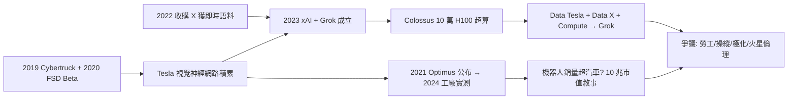

# 5.3 xAI、Optimus 與爭議（2023–）

## xAI：從 OpenAI 出走者到挑戰者

馬斯克是 OpenAI 2015 年的共同創辦人，2018 年因控制權分歧退出。2023 年 ChatGPT 爆紅後，他以「AI 必須求真、拒絕覺醒審查」為旗號成立 **xAI**，推出大模型 **Grok**，主打即時連接 X 平台數據、回答更少禁忌。

xAI 的算力擴張極激進：在田納西孟菲斯興建 Colossus 超算，號稱 10 萬張 H100，上線速度創紀錄。2024 年 xAI 估值突破 500 億美元，與 X、Tesla 形成數據閉環：Tesla 車隊的駕駛影像＋X 的文本語料＋Starlink 的邊緣傳輸，共同餵養 Grok。

技術路線可用一句話概括： $Data_{Tesla} + Data_{X} + Compute_{Colossus} \Rightarrow Grok$ 。

## Optimus：把車變成人

2021 年 AI Day 公布、2023 年後加速的 **Optimus（擎天柱）人形機器人**，本質是「會走路的 Tesla」：FSD 的視覺神經網路＋車用馬達＋電池，直接移植到雙足機器人上。馬斯克宣稱未來機器人銷量將超過汽車十倍，是 Tesla 市值破 10 兆美元的關鍵。

2024–2025 年 Optimus 已能在工廠做簡單分揀搬運，雖距通用仍遠，但展示了「電動車 → 自駕 → 機器人」的連貫路徑：Cybertruck/FSD 的積累，正是 AI 與機器人的地基。

## 爭議與影響：天才還是寡頭

- **勞工與管理**：極限工時、睡工廠文化被告上法庭；
- **市場操縱**：推文拉抬狗狗幣、Tesla 股價屢遭調查；
- **政治極化**：X 的演算法與本人發言加劇對立；
- **火星倫理**：殖民火星是延續文明還是富人逃票，爭論不休。

歷史評價或許會回到《銀河便車指南》的那句話：馬斯克一生都在試圖「提出正確的問題」——讓人類成為多行星物種、讓能源可持續、讓 AI 求真。答得對不對，尚無定論；但問題本身，已經改寫了三個產業。

## 因果鏈

- **前因**：Cybertruck/FSD 把 Tesla 從車廠變成 AI 公司，收購 X 補上文本數據，Starlink 補上全球傳輸——三塊拼圖缺一不可，才有 xAI 與 Optimus。PayPal 資金 → 火箭 → 電動車 → AI，這條三十年的因果長鏈在此收束。
- **後果**：xAI 與 Optimus 把馬斯克的戰場從物理世界推向智慧本身；爭議則把他從「鋼鐵人」推向「寡頭」的審判台。全書的終極因果是：**每一次成功都放大了下一次賭注，每一次賭注都製造了更大的爭議**。傳記至此未完——星艦還未登陸火星，Grok 還在追趕，Optimus 還在學走路。
