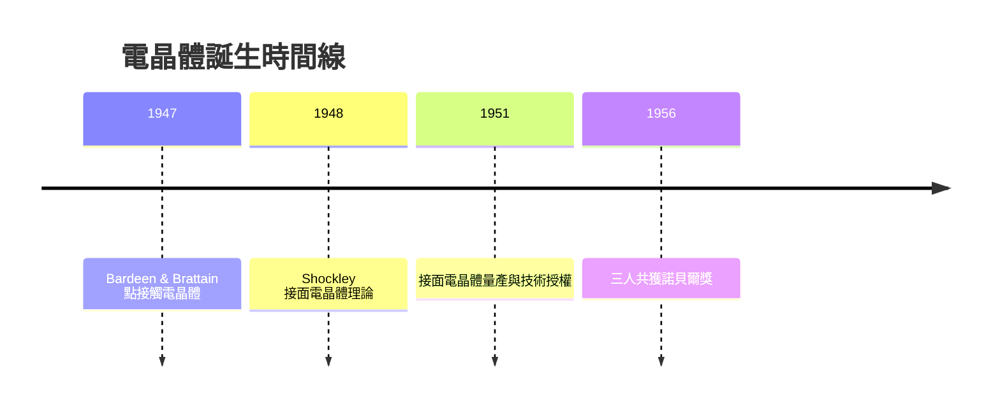

# 1.1 貝爾實驗室與電晶體的誕生(1947-1951)

## 一切始於那根鍺

第二次世界大戰結束後，貝爾實驗室的 William Shockley 率領一個固態物理小組，試圖以半導體取代脆弱、發熱又不可靠的真空管。1947 年 12 月，Shockley 的兩位部屬 John Bardeen 與 Walter Brattain 在鍺晶體上做出第一個「點接觸電晶體」（point-contact transistor）。Shockley 隨後在 1948 年提出更完整的接面電晶體（junction transistor）理論，並在 1951 年做出可量產的接面電晶體。

這個指甲大小的元件能以極小電流控制大電流，兼顧放大與開關——正是電子工業等待了半世紀的「固態繼電器」。三人於 1956 年共獲諾貝爾物理學獎。

## 為何是「固態革命」的前夜

電晶體初誕生時並不完美：點接觸型參數飄移、良率極低、頻率特性差。但貝爾實驗室在 1951-1952 年以象徵性授權金開放專利授權給數十家廠商，等於把一顆種子撒向整個美國工業界。半導體的物理知識已備，缺的只是把它推向大規模製造的人。

其中一個拿到授權、並被激發出野心的人，正是 Shockley 本人。

## 因果鏈

- 真空管的不可靠 → 戰後貝爾實驗室投入固態研究 → 電晶體問世（1947）。
- 貝爾的開放授權政策 → 半導體技術快速擴散 → Shockley 得以攜帶知識西行，為下一章的 Shockley 半導體實驗室鋪路。
- 電晶體的誕生 → 電子元件小型化的需求被滿足一半 → 但「如何廉價大量製造」的難題仍在，這正是快捷半導體日後用平面製程回答的問題。
