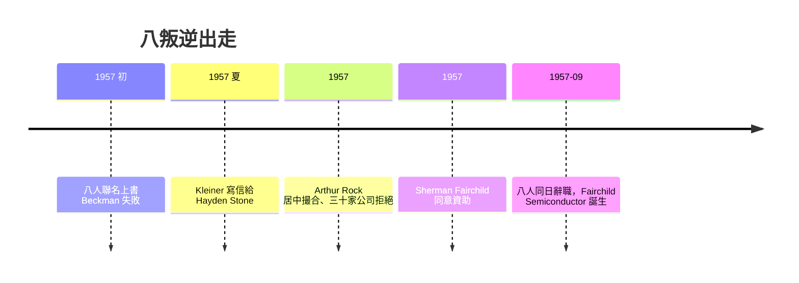

# 1.3 八叛逆出走(1957)

## 一封信與一個紐約客

1957 年夏天，八人湊錢打電報給紐約的 Hayden Stone 投資銀行，由 Eugene Kleiner 起草信件。銀行派出的合夥人 Arthur Rock（當時只是替老闆跑腿的年輕助理）聯絡了三十幾家公司，全數遭拒——一家電子零件公司竟要雇用「八個集體辭職的叛徒」？

最終是 Fairchild Camera and Instrument 的總裁 Sherman Fairchild 點頭。他是 IBM 大股東、發明家，正想為自己的相機與航空產品找一個半導體供應來源。他同意出資約 150 萬美元成立子公司 Fairchild Semiconductor，八人各持少量股權，並保留將來以 300 萬美元回購的選擇權。1957 年 9 月 18 日，八人一同遞出辭呈——Shockley 怒斥他們為「八叛逆」（Traitorous Eight）。

## Arthur Rock 與創投的火種

這樁交易在當時是異數：傳統上企業靠銀行貸款或自有資金創立，而「專業人才 + 外部股權資金 + 退出機制」的組合前所未見。Rock 在撮合過程中親身體驗到這種模式的威力，十年後他成為全美第一批專職創投家，並在 1968 年再次為 Noyce 與 Moore 募集 Intel 的資金。

八叛逆事件因此被公認為矽谷創投產業的起點：不是先有創投再有創業，而是先有八個敢走的年輕人。

## 因果鏈

- Shockley 管理失敗 → 八人求去 → 需要外部資金 → Hayden Stone 撮合 → Fairchild Camera 資助 → 快捷半導體成立（1957）。
- 八叛逆 + Rock 的經驗 → 股權式風險投資的可行性被證明 → 日後 Kleiner Perkins（Kleiner）、Sequoia（Rock 影響）等創投帝國的遠因。
- Fairchild 母公司「控股但不放手」的股權結構 → 為第 4 章的母子公司衝突埋下伏筆：當年成全他們的資本結構，最終也逼走了他們。
