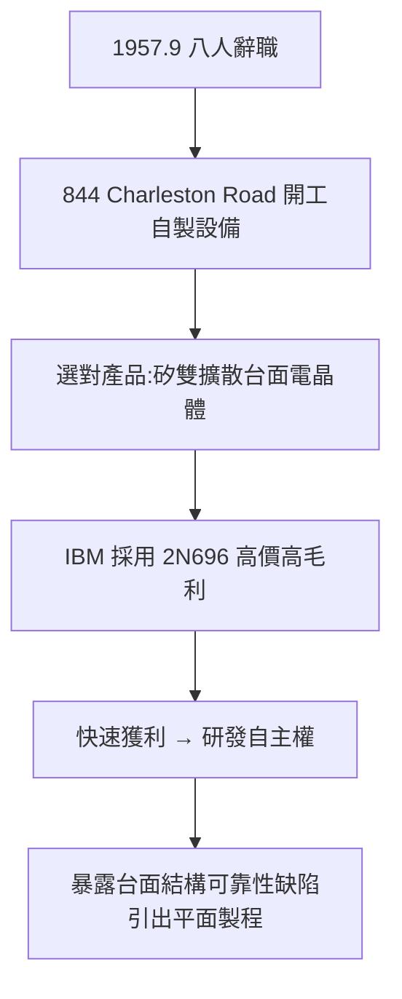

# 2.1 快捷半導體的創立(1957-1958)

## 查爾斯頓路 844 號的車庫精神

1957 年 10 月，八人在加州帕洛阿托查爾斯頓路 844 號（844 Charleston Road）一棟小房子裡開工，這就是 Fairchild Semiconductor 的起點。分工明確：Robert Noyce 負責全面營運與對外，Gordon Moore 管研發，Jean Hoerni 管物理，Jay Last 帶光刻與照相製版，Sheldon Roberts 管晶體生長，Victor Grinich 管測試，Julius Blank 管設備，Eugene Kleiner 管行政。

與 Shockley 時代最大的不同是文化：沒有打卡鐘、沒有心理測驗，人人持股、人人動手。Julius Blank 甚至自己車床加工真空擴散爐——因為當時根本買不到現成的半導體設備，一切自製。這種「科學家兼工人」的平等主義，後來成為整個矽谷的預設值。

母公司 Fairchild Camera and Instrument 出錢但不懂半導體，給了八人約一年的自由窗口。八人選擇的第一條產品線務實而聰明：不做 Shockley 執念的四層二極體，而做 IBM 與軍方急需的高速矽電晶體——用雙擴散（double-diffused）台面（mesa）技術切入市場。

## 第一桶金：雙擴散矽電晶體

1958 年，Fairchild 推出 2N696 矽台面電晶體，開關速度遠勝德州儀器（TI）的鍺電晶體，立即被 IBM 採用於電腦磁芯記憶體驅動電路，一顆售價高達 150 美元。公司創立第一年即獲利，1958 年營收約 50 萬美元，1959 年翻數倍。

這筆現金流至關重要：它讓八人證明了「技術領先 → 高毛利 → 再投入研發」的正循環，也讓母公司暫時無話可說。但諷刺的是，台面電晶體的成功也暴露了它的弱點——裸露的 P-N 結容易被污染、可靠性差。解決這個弱點的人，正是下一節的主角 Hoerni。

## 因果鏈

- Shockley 管理失敗 → 八人出走 → 母公司放手一年 → 平等持股文化 → 快速決策、自製設備。
- 選對市場（IBM 高速電腦需求）→ 2N696 高毛利 → 現金流支撐後續平面製程與 IC 研發。
- 台面電晶體的可靠性缺陷 → 倒逼 Hoerni 發明平面製程 → 下一節的技術躍遷。成功本身孕育了下一次革命。
