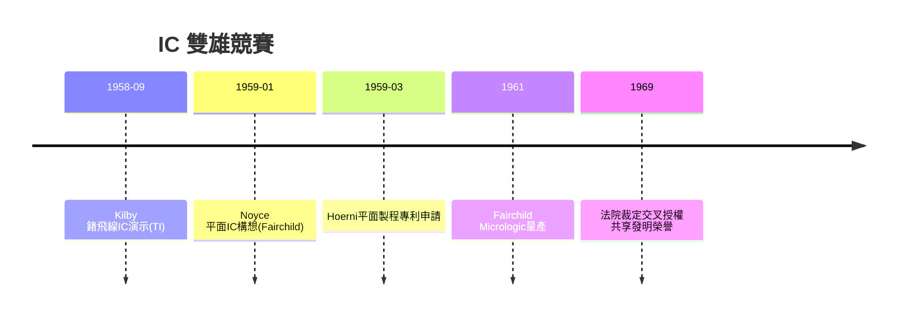

# 2.3 積體電路專利之爭(1958-1969)

## 兩位發明人，兩種積體電路

1958 年 9 月，德州儀器（TI）的新進工程師 Jack Kilby 在實驗室用鍺片、飛線把多個元件黏成「固態電路」，9 月 12 日演示成功。Kilby 的想法超前，但工藝是手工拼湊：元件間用金線連接，無法量產。

半年後，1959 年 1 月，Robert Noyce 在 Fairchild 的筆記本上寫下關鍵構想：利用 Hoerni 的平面製程，在同一片矽上做出電晶體、電阻、電容，再用蒸鍍在氧化層上的鋁線互連——整塊電路「自上而下」一次光刻完成，天然可量產。1959 年 7 月 Fairchild 申請專利（US 2,981,877），1961 年推出第一個商用 IC 系列 Micrologic。

專利戰隨即開打：TI 主張 Kilby 在先（1959 年 2 月申請），Fairchild 主張 Noyce 可製造性不同且有效。官司纏訟十年，最終 1969 年法院裁定雙方交叉授權、共列發明人——法律上的平手，產業上的分水嶺：Noyce 的平面型 IC 成為此後六十年所有晶片的範式，Kilby 的飛線式則成博物館藏品。

## 為什麼 Fairchild 贏了市場卻輸了專利獨占

Fairchild 贏在工程：Jay Last 帶領的 Micrologic 團隊 1961 年就交出觸發器、閘電路全系列，搶下阿波羅計畫訂單；而 TI 贏在法務與堅持。更關鍵的是，Fairchild 母公司為求和解，早早同意交叉授權，等於把最值錢的壟斷權拱手讓出。這為第 4 章的「母公司短視」再添一筆。

## 因果鏈

- 平面製程 → Noyce 的可量產 IC 構想 → Fairchild 搶得商用先機 → 軍事訂單湧入（第 3 章）。
- 母公司急於和解 → 交叉授權 → IC 專利未能形成壟斷租金 → Fairchild 被迫永遠靠「跑得比別人快」生存，為日後失速衰落埋因。
- Kilby vs Noyce 之爭 → 確立「可製造性才是發明」的矽谷價值觀 → 影響後來 Intel 的製程至上主義。
