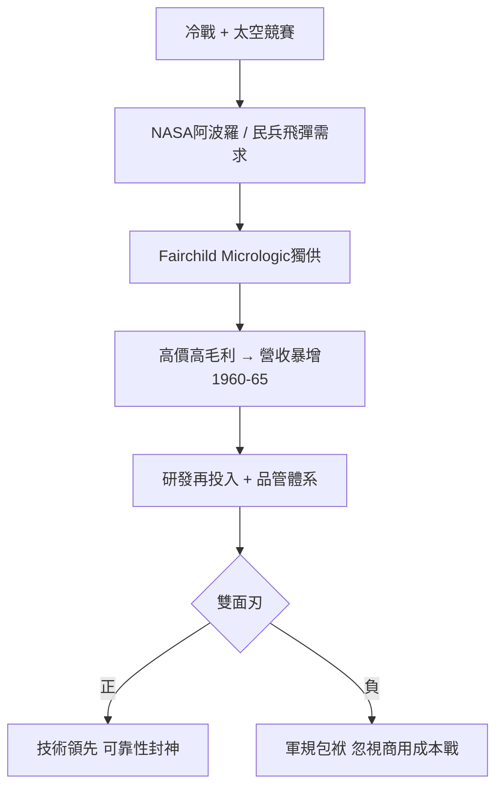

# 3.1 軍事與太空訂單(1960-1965)

## 阿波羅與民兵：不計成本的客戶

1961 年，Fairchild 推出 Micrologic IC 系列，恰逢美國最焦慮的時刻：蘇聯加加林上天、古巴飛彈危機前夜，甘迺迪宣布十年內登月。NASA 阿波羅引導電腦（AGC）需要體積小、重量輕、功耗低、絕對可靠的邏輯電路——平面型 IC 是唯一答案。Fairchild 拿下大批訂單，一片小小的矽晶片被送上月球。

同時，空軍民兵 II（Minuteman II）洲際飛彈的制導系統也全面採用 Fairchild 與 TI 的 IC。1962-1965 年間，美國軍方採購了全美生產的絕大多數 IC，價格是今天的數百倍（一顆閘電路超過 100 美元），但軍方只問可靠、不問價格。

結果是爆炸性成長：Fairchild 營收從 1960 年約 1000 萬美元飆升至 1965 年逾 1.3 億美元，員工從數百人增至上萬人，山景城廠房日夜燈火通明。軍事訂單扮演了「創投 + 第一客戶」的雙重角色：高毛利補貼了研發，高標準逼出了品質。

## 雙面刃：溫室裡的巨人

但蜜月藏著毒藥。軍規要求小批量、多品種、極端可靠，與商用市場要的大批量、低成本、快速迭代背道而馳。Fairchild 為軍方養出龐大的品管與文件體系，卻對消費性電子降價曲線反應遲鈍。當 1960 年代中期 TI 與仙童以外的對手開始用塑膠封裝、自動化測試打價格戰時，Fairchild 的軍規包袱反而成了累贅。

## 因果鏈

- IC 可量產 + 冷戰需求 → 軍事太空訂單 → 現金流與規模化 → 黃金年代。
- 軍事高毛利 → 掩蓋成本結構問題 → 對商用價格戰鈍感 → 1960 年代末市占流失的遠因。
- 軍方「不計成本要可靠」→ 強化平面製程與品管 → 反過來支撐摩爾定律的物理基礎：沒有可靠製程，就沒有每年翻倍的元件數。
