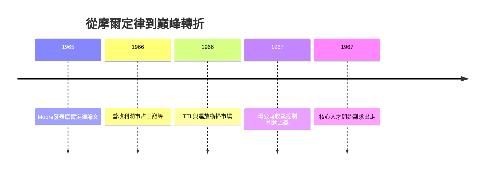

# 3.3 摩爾定律與市占巔峰(1965-1967)

## 一篇四頁論文預言五十年

1965 年，研發主管 Gordon Moore 受《Electronics》雜誌邀稿，整理過去六年數據發現：單晶片可容納元件數每年翻倍，成本不變。他大膽外推十年，寫下日後稱為摩爾定律的預言。數學形式可寫為：

$$n(t) = 2^{(t-1962)}$$

其中 $n(t)$ 為第 $t$ 年單晶片元件數（以 1962 年為基準歸一）。1975 年 Moore 將斜率修正為每兩年翻倍：

$$n(t) = 2^{(t-1975)/2 + c}$$

這不是物理定律，而是自我實現的路線圖：因為 Fairchild 證明它連續對了五年，全行業開始照著它投資設備、研發、建廠，反而讓它繼續對下去五十年。

## 巔峰：半導體世界的中心

1966-1967 年是 Fairchild 的絕對巔峰：市占率穩居全美第二、僅次於 TI，TTL 邏輯（Seriest 7400 前身概念）、運放、電晶體三線開花，營收、利潤、聲望皆達頂點。Noyce 被媒體稱為「矽谷市長」，Moore 是技術先知，山景城成為全球電子工程師的麥加。

但巔峰即轉折：母公司 Fairchild Camera 看到子公司賺錢，開始收緊控制——利潤上繳、升遷凍結、股票選擇權縮水。八叛逆當年為自由而出走，如今發現自己成了大公司裡的中層幹部。Noyce 在回憶錄中說：「我們只是想做事，但總部只想報表。」

## 因果鏈

- 平面製程 + 軍事規模化 → 數據支撐摩爾定律 → 路線圖凝聚全行業 → 反哺 Fairchild 投資信心 → 巔峰。
- 巔峰利潤 → 母公司加強汲取 → 自主權喪失 → 人才離心 → 第 4 章大出走。成功招致控制，控制扼殺成功——這是 Fairchild 循環的核心悖論。
- 摩爾定律的預言 → 掩蓋組織危機 → 外界只見成長曲線 $n(t)$，不見內部離職曲線也在指數上升。
