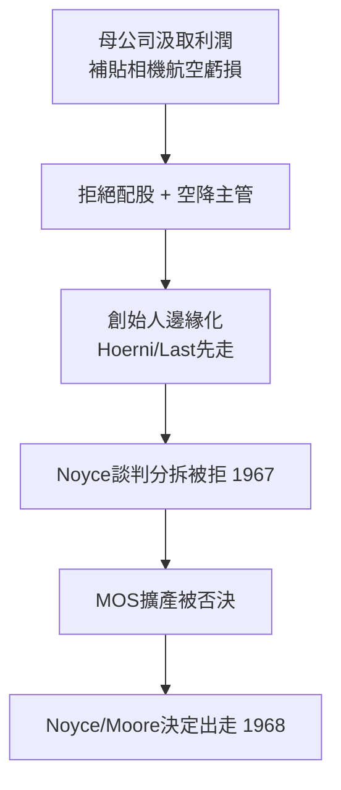

# 4.1 母公司衝突與管理危機(1967-1968)

## 東岸報表 vs 西岸實驗室

Fairchild Camera and Instrument 總部在紐約 Syosset，思維是傳統軍工複合體：中央集權、預算層層審批、利潤全部上繳。而 Fairchild Semiconductor 在加州，信奉的是車庫文化：快速試錯、工程師當家、股票激勵。

1966 年後矛盾總爆發：母公司把半導體部門的利潤拿去補貼相機與航空部門的虧損，卻拒絕給半導體骨幹新的股票選擇權；人事任命上，總部空降不懂半導體的主管，架空 Noyce； Hoerni、Last、Kleiner 等創始人相繼被邊緣化或出走（Hoerni 1961 年創 Union Carbide 電子部、Last 1964 年創 Amelco）。

Noyce 多次飛往東岸談判，要求分拆上市或更高的自主權，均被拒。Moore 在實驗室日記裡寫道：「我們發明了未來，但無權決定未來的預算。」當年 Sherman Fairchild 資助八人的 150 萬美元，如今變成套牢他們的金手銬——母公司擁有全部股權，創始人只是雇員。

## 壓垮駱駝的最後一根稻草

1967 年連續兩件事：母公司否決了在新廠擴產 MOS 的計畫（正是矽閘最需要產能時），又否決了 Noyce 提出的骨幹配股方案。Noyce 與 Moore 對視一眼，心裡都明白：1957 年的劇本要重演了——只是這次，出走的是他們自己。

## 因果鏈

- 軍事訂單高利潤 → 母公司依賴汲取 → 自主權喪失 → 人才離心 → 大出走。
- 1957 年股權結構（母公司全資控股）→ 1967 年無從反制 → 歷史種下的因，十年後結果。
- 管理危機 → 倒逼 Noyce、Moore 創業 → Intel 誕生 → 矽谷「出走—創業—超越老東家」的範式正式確立。
