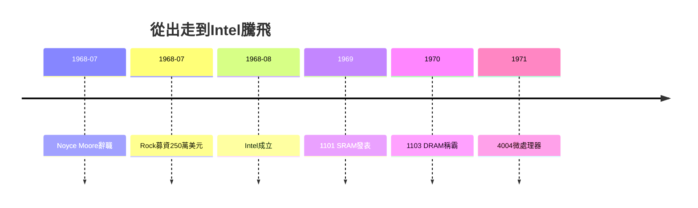

# 4.2 Noyce與Moore創立Intel(1968-1969)

## 兩頁商業計畫書，250 萬美元

1968 年 7 月，Noyce 與 Moore 辭職。Arthur Rock——十一年前撮合八叛逆的那個年輕人，如今已是舊金山知名金融家——為他們寫了一份兩頁商業計畫書，目標是做半導體記憶體。Rock 打了幾個電話，幾天內募到 250 萬美元，創下當時創投募資紀錄。投資人中包括 Sherman Fairchild 本人（頗具諷刺意味）與 Rock 自己。7 月 18 日，NM Electronics 成立，一個月後更名 Intel（Integrated Electronics）。

Intel 吸取 Fairchild 全部教訓：全員股票選擇權、扁平管理、只做最前沿（先做 SRAM、DRAM，再做微處理器）。Andy Grove（同從 Fairchild 出走）帶來紀律，Faggin 帶來矽閘，Intel 把 Fairchild 發明卻未商業化的 MOS 紅利全部兌現：1969 年 1101 SRAM、1970 年 1103 DRAM 橫掃市場、1971 年 4004 微處理器問世。

Noyce 的管理哲學——「不設專屬車位、不設高管餐廳、知識型權力」——直接是對 Shockley 與 Fairchild Camera 官僚制的否定。這套哲學後來寫進《High Output Management》，成為矽谷管理聖經。

## 背叛還是傳承？

Fairchild 總部氣得跳腳，卻無可奈何：競業條款在加州幾乎無效（加州商業與職業法 §16600），人才自由流動受法律保護。這條法律偶然地成為矽谷超越波士頓 128 號公路的關鍵制度紅利。

## 因果鏈

- 母公司壓制 → Noyce/Moore 出走 → Rock 募資 → Intel 成立 → MOS 商業化 → 微處理器時代。
- Fairchild 矽閘研發（因）→ Faggin 追隨出走（緣）→ Intel 兌現（果）：技術在老東家開花，在新公司結果。
- 加州競業無效法律 + 股權激勵範式 → 人才高速流動 → 矽谷生態的制度基礎確立，影響直至今日。
