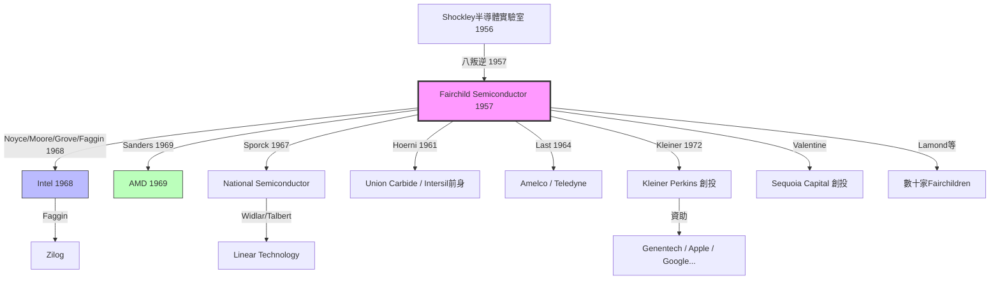

# 4.3 AMD與Fairchildren譜系(1969-1970)

## Jerry Sanders：銷售員的復仇

1969 年 5 月，Fairchild 銷售主管 Jerry Sanders 在公司政治鬥爭中被掃地出門——新任總經理從摩托羅拉空降，帶來自己的班底。Sanders 憤而與七名 Fairchild 同事創立 Advanced Micro Devices（AMD），口號是「要做比 Fairchild 更公平的公司」。AMD 初期做第二供應商（second source），為 Fairchild 與 Intel 的晶片做相容替代，以銷售與服務取勝，後來成長為 CPU 雙雄之一。

Sanders 的出走證明：Fairchild 流失的不只是科學家，還有銷售與管理人才。1968-1970 年間，離職潮如潰堤：Charlie Sporck 帶數十人投奔 National Semiconductor（1967），其後任 National CEO 把它做成類比巨頭；Pierre Lamond、Don Valentine（後創 Sequoia Capital）紛紛自立門戶。據統計，1960-1970 年代直接源自 Fairchild 的公司超過 50 家，世稱「Fairchildren」（快捷之子）。

## Fairchildren 譜系圖

上圖只是冰山一角。完整譜系若展開，蘋果、甲骨文、Google 的早期資金都可追溯到 Kleiner Perkins，而 Kleiner 正是八叛逆之一。這就是「一家公司變成一個生態系」的完整鏈條。

## 因果鏈

- 母公司內鬥 + 空降文化 → Sanders 被逐 → AMD 誕生 → 第二供應商模式 → 商用價格戰加劇 → 反噬 Fairchild 本體。
- 大出走（因）→ Fairchildren 譜系（果）→ 創投業（Kleiner Perkins、Sequoia）→ 資金回流孵化下一代 → 矽谷正反饋飛輪啟動。
- Fairchild 的衰落與矽谷的繁榮是同一枚硬幣的兩面：母體把養分分給子體，母體萎縮、生態繁盛。這正是第 5 章歷史評價的核心。
