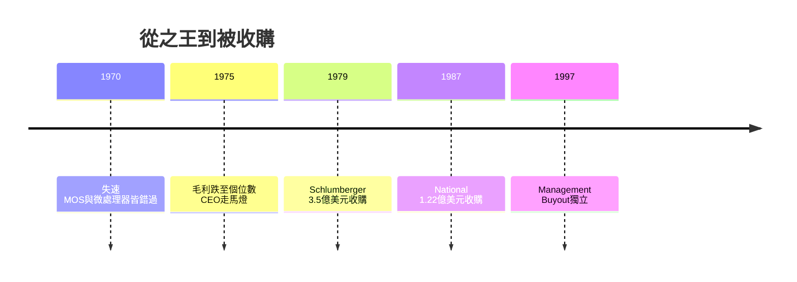

# 5.1 衰落與兩度收購(1970-1997)

## 失速的十年

1970 年代，Fairchild 陷入「什麼都做、什麼都不精」的困境：雙極邏輯被 TI 與 National 以成本壓制，MOS 記憶體被 Intel 的 1103 DRAM 橫掃，微處理器又錯過第一班車（Intel 4004、8080 皆出自 Fairchild 舊部之手）。管理層走馬燈式更換，1970-1978 年間換了五任 CEO，每任都從東岸空降，每任都帶來新的重組與裁員。

財務上，公司從 1960 年代 30% 以上的毛利率跌至 1970 年代中期的個位數。1979 年，母公司 Fairchild Camera 財務惡化，決定以約 3.5 億美元把整個集團賣給法國石油設備巨頭 Schlumberger——一家做油田測井的公司來管半導體，文化錯配可想而知。Schlumberger 注資買設備，卻不懂摩爾定律 $n(t) = 2^{t/\tau}$ 背後的速度哲學：半導體贏家不是設備最貴的，而是迭代最快的。

1987 年，Schlumberger 認賠，將 Fairchild Semiconductor 以 1.22 億美元賣給 National Semiconductor。曾經的半導體之王，淪為對手的一個部門。山景城老廠關閉，查爾斯頓路 844 號掛上別家招牌。

## 因果鏈

- 母公司汲取 + 人才外流 → 研發斷層 → 產品線全面落後 → 財務惡化 → 被賣。
- Schlumberger（石油思維）→ 重資產輕迭代 → 與摩爾定律速度背道而馳 → 二度轉賣。買家不懂因果鏈，再貴的設備也救不了。
- 被收購的屈辱 → 倒逼殘部聚焦求生 → 為 1997 年管理層收購後的「功率轉型」留下火種：大而全失敗，小而專才有活路。
