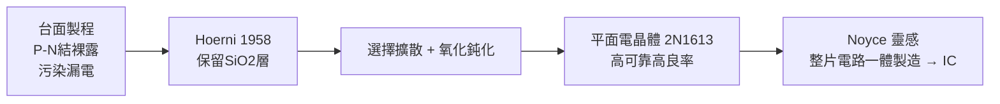

# 2.2 平面製程的突破(1958-1959)

## Hoerni 的靈感：讓二氧化矽留下

1958 年，瑞士物理學家 Jean Hoerni 苦惱於台面電晶體的漏電與污染問題。當時業界做法是把矽片刻蝕成台面狀，P-N 結裸露在空氣中，極易沾染鈉離子而失效。

Hoerni 的逆向思考是：與其蝕刻掉二氧化矽（ $SiO_2$ ）保護層，不如把它留下。他利用熱氧化在矽片上生長一層緻密的 $SiO_2$ ，在其上開窗做選擇性擴散（硼、磷），擴散完後仍以氧化層覆蓋保護 P-N 結，只在需要接線處開接觸孔。剖面看去，整個結構是平的——故名「平面製程」（planar process）。

1959 年 3 月 Hoerni 申請專利，Fairchild 隨即推出 2N1613 平面電晶體：漏電小一個數量級，可靠性與良率大幅提升，且天然適合批量光刻。這是半導體史上最重要的製程發明之一：直到今天，所有矽晶片仍是平面製程的子孫。

## 從製程到哲學：可製造性

平面製程的深層意義不在單顆電晶體，而是「可批量製造」。氧化層同時起到鈍化、掩膜、絕緣三重作用，配合 Jay Last 改良的光刻照相技術， Fairchild 可以在同一片矽圓上一次做出上百顆特性一致的電晶體。這把良率公式從加法變成乘法：

$$Y = \prod_{i=1}^{N} y_i$$

其中每一步驟良率 $y_i$ 都因氧化層保護而提高，總良率 $Y$ 呈指數級改善。Noyce 看到這一點時立刻意識到：既然電晶體可以連在一起做，為什麼不能把整條電路都做在同一片矽上？

## 因果鏈

- 台面電晶體的高毛利 → 養活團隊 → Hoerni 有餘裕研究可靠性 → 平面製程誕生。
- 平面製程（鈍化 + 批量）→ 良率與可靠性躍升 → 成本下降、軍方敢用 → 黃金年代訂單的前提。
- 平面製程的「同一平面做多個元件」→ 直接啟發 Noyce 的積體電路構想 → 下一節 IC 專利之爭。製程驅動設計，設計反過來定義公司命運。
