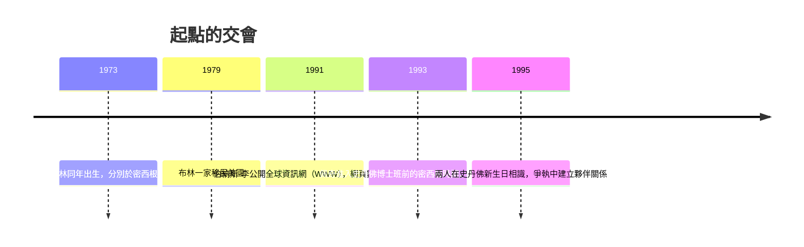

# 1.1 兩位移民之子的成長背景（1973-1995）

Google 的故事始於兩個家庭的教育理想。拉里·佩奇（Larry Page）1973 年生於美國密西根州東蘭辛，父親卡爾·佩奇是密西根州立大學電腦科學教授，母親是資料庫程式設計教師。佩奇六歲時就迷上電腦與樂高，家中車庫堆滿拆解的科技雜物。他在密西根大學讀電腦工程時，曾用樂高做出一台可程式化的噴墨印表機，並對「運輸系統」與「大規模組織的效率」產生執念——這個執念後來直接催生了 PageRank。

謝爾蓋·布林（Sergey Brin）1973 年生於蘇聯莫斯科，父親米哈伊爾是數學家，因蘇聯對猶太人的歧視無法從事理想學術工作，1979 年舉家移民美國。布林在馬里蘭大學提前畢業，進入史丹佛博士班。移民家庭對「自由取得資訊」的珍惜，成為兩人日後「組織全世界資訊」使命的情感基礎。

兩人 1995 年在史丹佛相識。傳說中的初次見面並不融洽——佩奇覺得布林外向傲慢，布林覺得佩奇固執孤僻——但他們很快發現彼此都癡迷於同一個問題：**數學與資料能否取代人的判斷？** 這種「用演算法對抗主觀」的品味，構成了 Google 文化的原點：工程師至上、數據決策、極簡介面。

## 因果鏈

- **前因**：網路 1991 年誕生後網頁量指數成長，但 1990 年代的搜尋引擎（AltaVista、Yahoo 目錄）以關鍵字匹配為主，結果品質低落；蘇聯壓抑的學術環境與美國工程師家庭的教育，塑造了兩人「資訊應該自由且可信」的價值觀。
- **後果**：兩人的相識使佩奇即將展開的「引用分析」博士題目有了數學上的合作者，直接催生 BackRub 與 PageRank（1.2、1.3）。
