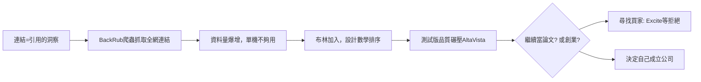

# 1.2 BackRub 與史丹佛數位圖書館計畫（1996-1998）

1996 年，佩奇在史丹佛尋找博士論文題目，指導教授 Terry Winograd 建議他研究「網頁之間的連結結構」。佩奇注意到一個關鍵洞察：**連結是一種引用**。學術論文的影響力由被引用次數衡量，網頁的權威性同樣可以由指向它的連結衡量。他原本想做的就是分析這個圖結構——BackRub 之名來自「backlink」（反向連結）。

佩奇寫了一隻爬蟲收集整個網路的連結關係，但資料量大到單機難以處理。此時布林加入，他對資料探勘與數學的長才讓計畫脫胎換骨：兩人合力設計出一個 ranking 函數，先用連結計算每頁的權重，再結合連結文字（anchor text）判斷相關性。1997 年上線的測試版搜尋引擎品質明顯超越 AltaVista：搜「Bill Clinton」第一頁不會出現色情網站。

史丹佛對這個計畫極為寬容：Digital Library 計畫提供資金與設備，宿舍房間成為伺服器機房，校方後來以象徵性價格授權 PageRank 專利。這是史丹佛孵化生態系的典型案例——學術資源、風險資本與創業文化在帕洛阿圖這片土地上互相餵養。

## 因果鏈

- **前因**：1.1 中兩人的相識提供了數學人力；1990 年代搜尋引擎品質低落提供了問題意識；史丹佛數位圖書館計畫提供了算力與資金。
- **後果**：兩人曾試圖以約 100 萬美元把技術賣給 Excite 與 AltaVista 遭拒（買家嫌它「太好、會讓用戶太快離開」），被拒的挫敗促使他們在 1998 年自立門戶（2.1），PageRank 數學的細節則見 1.3。
