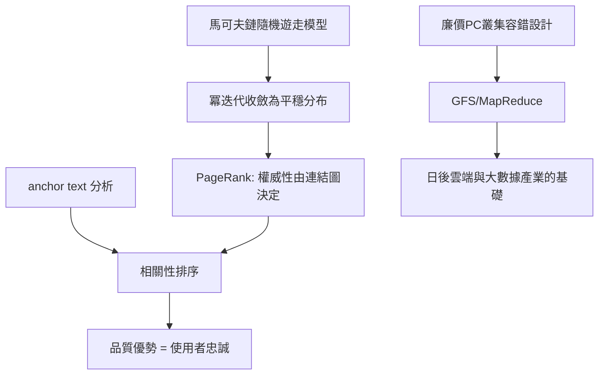

# 1.3 PageRank 的數學原理（1998）

PageRank 的核心是一個直觀的遞迴定義：**一個網頁的重要程度，由指向它的連結決定，而每個連結的權重又取決於連結來源網頁自身的重要程度。** 這看似循環定義，卻可以用線性代數求解。

設 $PR(p)$ 為網頁 $p$ 的排名值， $L(p)$ 為指向 $p$ 的網頁集合， $C(q)$ 為網頁 $q$ 的出連結總數，則：

$$PR(p) = \frac{1-d}{N} + d \sum_{q \in L(p)} \frac{PR(q)}{C(q)}$$

其中 $d \approx 0.85$ 是阻尼係數（damping factor），代表使用者以機率 $d$ 點連結、以 $1-d$ 隨機跳到任一頁。隨機跳躍項確保這個轉移矩陣是遍歷的，保證收斂。整個系統等價於求一個馬可夫鏈（Markov chain）的平穩分布：把網路想成一個隨機遊走者在無窮漫步，**每頁被造訪的長期機率就是它的排名**。這個冪迭代法（power iteration）每輪只需稀疏矩陣乘法，可大規模平行化——這正是它日後能在廉價硬體上跑全網的關鍵。

1998 年論文《The Anatomy of a Large-Scale Hypertextual Web Search Engine》還補上兩塊拼圖：anchor text 讓「別人如何描述這個連結」成為相關性訊號；而系統架構刻意設計在廉價 PC 叢集上，用軟體容錯取代昂貴伺服器——這套思維直接演進為 Google 檔案系統（GFS）與 MapReduce，成為整個雲端時代的技術基石。

## 因果鏈

- **前因**：BackRub 的連結資料需要一套可規模化的排序理論（1.2）；佩奇的圖論素養與布林的矩陣運算能力把「引用分析」變成可計算的馬可夫鏈。
- **後果**：排名品質成為產品的護城河，直接支撐車庫創業後的使用者成長（2.1）；「在廉價硬體上做分散式容錯」的架構哲學孕育了 GFS、MapReduce、Bigtable，是第三章雲端擴張與整個大數據產業的技術前因。
