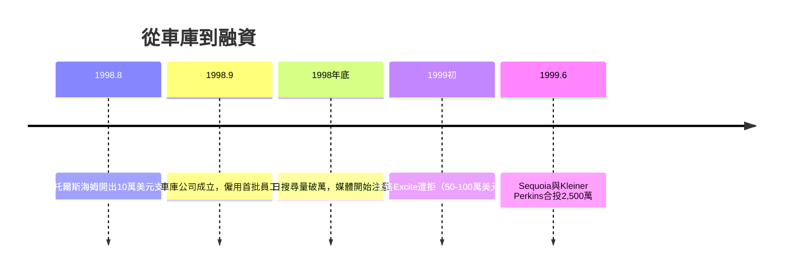

# 2.1 車庫創業與早期融資（1998-1999）

1998 年 9 月，Google 公司在蘇珊·沃西基（Susan Wojcicki）位於門洛帕克 Menlo Park 的車庫裡成立。佩奇與布林向 Sun 共同創辦人安迪·貝托爾斯海姆（Andy Bechtolsheim）展示了搜尋引擎 demo，對方聽完只說了一句「我不太確定細節，但這比其他搜尋引擎都好」，當場開了一張 10 萬美元的支票——收款人寫的是還不存在的「Google Inc.」。這張支票逼著兩人在幾週內完成公司登記。

首年公司只有十來人，伺服器用積木架堆疊，桌面是門板。1999 年 6 月完成 2,500 萬美元 A 輪融資，投資人包括紅杉資本（Sequoia）與凱鵬華盈（Kleiner Perkins）兩大頂級創投——難得地同時領投。但當時 Google 幾乎沒有營收，兩位創辦人甚至一度想賣掉公司：1999 年他們開價 100 萬美元向 AltaVista 求售、又向 Excite 開價 75 萬（後降到 50 萬），全部被拒。歷史反覆證明：**被拒絕保住了 Google**。

這段時間的另一個關鍵決定是產品哲學：首頁只有一個搜尋框與 logo，沒有入口網站式的新聞、天氣與廣告轟炸；每個搜尋結果頁清楚標示廣告與自然結果的界線；「Don't be evil」（不作惡）成為 2000 年寫入行為準則的信條。極簡不是美學偏好，而是品質宣言——在入口網站用雜亂頁面餵廣告的時代，乾淨的 Google 首頁本身就是競爭武器。

## 因果鏈

- **前因**：BackRub 的品質優勢（1.3）讓 demo 具說服力，貝托爾斯海姆的支票成為觸媒；被 AltaVista、Excite 拒絕反而留下創業機會。
- **後果**：A 輪資金換來了時間，但「有流量沒營收」的壓力直接逼出 2000 年的 AdWords 廣告實驗（2.2）；「不作惡」信條與乾淨介面則成為日後品牌信任與監管爭議（5.2）的雙面前因。
