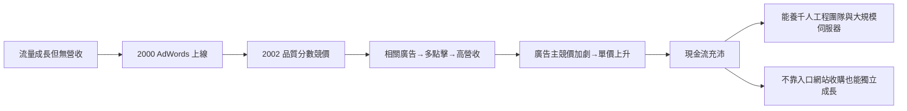

# 2.2 AdWords 與商業模式革命（2000-2002）

創業初期的 Google 陷入了「成長的悖論」：流量越漲，頻寬與伺服器成本越重，卻沒有營收。早期的解法是賣搜尋技術授權與入口網站的贊助連結，但規模太小。2000 年 10 月，Google 推出 AdWords——一個與競爭對手 Overture（GoTo.com）類似但更精緻的機制：廣告主競標關鍵字，廣告只在使用者搜尋該關鍵字時出現在結果頁右側。

真正的革命在 2002 年的 AdWords Select 版本：引入 **CPC 競價 × 品質分數（Quality Score）** 的排名公式。廣告排序不只看誰出價高，還看點擊率與相關性：

$$\text{排序分數} \approx \text{出價} \times \text{預期點擊率} \times \text{品質分數}$$

這形成了著名的飛輪：相關的廣告獲得更多點擊 → 點擊多且不滿意率低 → Google 收入增加且用戶體驗不被破壞 → 更多廣告主湧入競價 → 單價上升。與 GoTo.com 純出價模式相比，品質分數讓「騷擾式廣告」自然被淘汰——商業利益與使用者利益第一次被設計進同一個演算法。2003 年推出 AdSense，把廣告網路延伸到第三方網站，完成「搜尋 + 聯播網」的雙引擎。

## 因果鏈

- **前因**：2.1 中資金雖到位但缺乏營收模式，流量成本壓力倒逼變現實驗；Overture 已驗證關鍵字競價的市場，Google 用品質分數做出差異化。
- **後果**：印鈔機啟動，使 Google 有本錢在 2004 年前後推出 Gmail、地圖等長期投資產品（3.1），並以 16.5 億美元收購 YouTube（3.2）；但「廣告即商業模式」也埋下日後一切監管矛盾的種子——公司利益與使用者注意力的綁定，正是 5.2 反壟斷與隱私爭議的根源。
