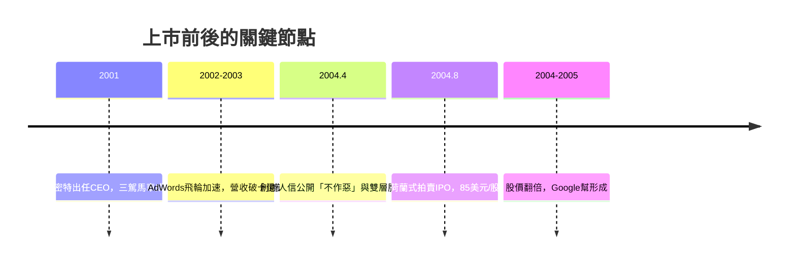

# 2.3 首次公開上市（2004）

2004 年 4 月 1 日，Google 公布一封佩奇與布林的創辦人信：「Google 不是一家傳統公司」（An Owner's Manual for Google's Shareholders），宣告「不作惡」將寫進公司章程，並保證不會為了短期季報犧牲長期利益。市場把愚人節的日期當成玩笑，這封信卻成為科技史上最重要的公司宣言之一。

8 月 19 日，Google 以獨特的荷蘭式拍賣（Dutch auction）上市，讓散戶也能以接近機構的價格認購，避開華爾街承銷商的傳統分配權力——這是對投資銀行秩序的一次刻意挑釁。每股 85 美元，籌資 16.7 億美元，估值約 230 億。兩位創辦人堅持發行 A/B 雙重股權結構：佩奇、布林與施密特（Eric Schmidt，2001 年受董事會之請出任 CEO）持有的 B 類股每股 10 票，確保創辦人永遠掌握決策權。後來的 Facebook、Snap 都效仿這個「創辦人掌控」模板。

上市前一年，公司已完成關鍵轉型：施密特的「成人監護」（adult supervision）補齊了管理與對外溝通；2003 年營收衝上 14.6 億美元、獲利約 1 億，證明 AdWords 飛輪不僅成立而且還在加速。上市當天股價漲 18%，之後一年翻倍。財富效應創造了數千名百萬美元級員工，他們離職後成為矽谷天使投資與新創浪潮（所謂「Google 幫」）的資金來源。

## 因果鏈

- **前因**：AdWords 的營收爆發（2.2）使 IPO 從「求生」變成「選擇時機」；創辦人對華爾街的不信任催生拍賣制與雙層股權；施密特的加入消除了董事會對管理成熟度的疑慮。
- **後果**：上市帶來的資金與貨幣化股票，成為第三章一切擴張的彈藥——收購 Android 與 YouTube、招募頂尖工程師、全球資料中心建設（3.1-3.3）；雙層股權則保證了 2015 年 Alphabet 重組（4.1）由創辦人意志主導的可能。
