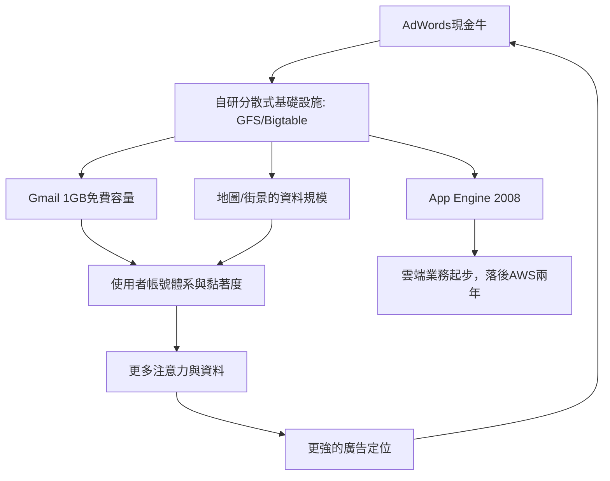

# 3.1 產品矩陣：Gmail、地圖與雲端（2004-2008）

IPO 之後，Google 開始把 AdWords 賺到的錢轉化為「用免費產品綁定使用者注意力」的產品帝國策略，每一個產品都同時服務三個目標：增加使用者停留時間、收集更多資料、餵養廣告引擎。

2004 年 4 月 1 日，Gmail 以 1GB 免費容量問世（當年 Hotmail 只給 2MB），外界以為是愚人節玩笑。1GB 在當年是奢侈的架構挑戰，靠的正是 1.3 預言的分散式檔案系統 GFS 與 Bigtable——**儲存成本曲線的下滑 + 自研分散式技術 = 免費容量的商業武器**。Gmail 的意義遠超電郵：它把使用者的信件內容納入索引，廣告可依內容投放（爭議由此而來），並讓使用者長期黏著在 Google 帳號系統上。

2005 年上線 Google Maps，收購 Keyhole 取得衛星影像技術，2007 年推出 Street View 街景。地圖很快成為行動時代的殺手級應用，也成為「本地廣告」這座金礦的入口——在地搜尋的商業價值遠高於一般搜尋。同時期，Google Docs & Spreadsheets（2006，源自 Writely 收購）開始把辦公室軟體搬上瀏覽器，直接挑戰微軟的現金牛 Office，逼微軟分心防禦。

2008 年 4 月推出 Google App Engine，是公司正式進入雲端運算市場的第一步，追趕 2006 年就已推出 EC2 的亞馬遜 AWS。Google 雲端的起步之所以遲緩，正因為內部早已「人人都在雲上」——為自己服務的基礎設施（GFS、MapReduce、Bigtable、Spanner）太完善，反而缺少把內部技術變成對外產品的商業急迫感。

## 因果鏈

- **前因**：2.3 的上市資金與 1.3 的分散式架構哲學，使「免費大容量」與「全球資料基礎設施」成為可行；微軟的強勢則提供了 docs 產品的競爭動機。
- **後果**：帳號體系與多產品黏著度為 Android 的推廣（3.2）鋪路；為自建而生的基礎設施技術人員與經驗，成為 2010 年代 Google Cloud 業務（3.3、4.1）的資產；免費產品換資料的模式則持續餵養 5.2 的隱私監管爭議。
