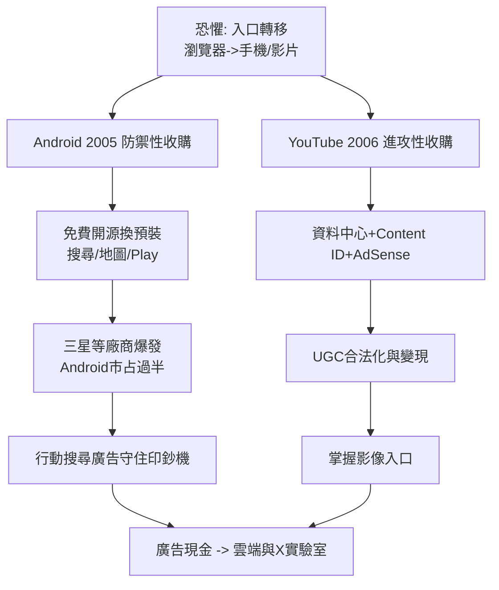

# 3.2 Android 與 YouTube：平台級收購（2005-2007）

2005 到 2006 年，Google 做了公司史上最重要的兩筆收購：Android（2005，年中完成，傳聞僅約 5,000 萬美元）與 YouTube（2006 年 10 月，16.5 億美元全股票）。兩筆交易的邏輯完全不同，卻共同回答了同一個恐懼：**如果通往資訊的入口從瀏覽器變成別的東西，Google 會不會被繞過去？**

Android 的故事始於防禦。當時微軟的 Windows Mobile 與諾基亞的 Symbian 主導手機，Google 內部判斷：如果手機作業系統被單一廠商鎖死，搜尋框就可能被換掉，AdWords 印鈔機將斷流。安迪·魯賓（Andy Rubin）的 Android 團隊只有 20 多人，Google 買下它後採取了天才的策略：作業系統免費開源（AOSP），以 Apache 授權釋出，換取手機廠商預裝 Google 搜尋、Gmail、地圖與 Play 商店。這是一場典型的「用免費換入口」戰爭：Google 貼錢做系統，賺回的是行動搜尋廣告。2007 年 iPhone 發布、2008 年 HTC Dream（G1）上市，Android 從笨拙追趕到 2010 年後靠三星等廠商迅速超越 iOS 市占。沒有 Android，Google 在行動時代將淪為 iPhone 上的一個 App。

YouTube 則是進攻。2005 年由三位 PayPal 前員工創立的 YouTube，靠 Flash 串流與嵌入語法引爆使用者自製影片（UGC），流量暴漲的同時版權訴訟與頻寬帳單也暴漲——每月頻寬成本數百萬美元，新創根本燒不起。Google 自己的 Google Video 品質更好、技術更強，卻輸在社群。佩奇與布林親自拍板溢價收購，華爾街一片譁然，認為買貴了。但 Google 帶來了三樣 YouTube 沒有的東西：全球資料中心與頻寬議價能力、Content ID 版權指紋系統（讓唱片公司從提告轉為分潤）、以及 AdSense 式的廣告變現機器。到 2010 年 YouTube 已是全球第三大網站，「看影片」從電視行為變成搜尋行為，Google 就此掌握了文字與影像兩種資訊入口。

兩筆收購的共同組織學意義是：Google 學會了「買下未來」。內部孵化擅長搜尋與基礎設施，但社群產品與作業系統生態需要速度與外部基因。收購後的高自主管理（YouTube 長期獨立運營於聖布魯諾）也成為後來收購 DeepMind（4.2）的模板。

## 因果鏈

- **前因**：2.3 上市帶來的股票貨幣與現金，使大額收購成為可能；2.2 的廣告飛輪提供了「免費換入口」的財務底氣——虧錢的系統與影片網站，只有 Google 養得起；iPhone 前夜的平台焦慮提供了決策壓力。
- **後果**：Android 保住了行動搜尋入口，直接支撐 3.1 地圖等產品在手機上的爆發，並為 2010 年代的 App 生態與 Google Play 分潤奠基；YouTube 則把公司從文字資訊推向影音資訊，內容審核與版權治理難題就此埋下，成為 5.2 監管風暴與 5.3 資訊秩序討論的前因；「收購生態系」的成功經驗，強化了公司日後敢於高價買下 DeepMind 與大舉投資 AI 的組織膽識。
