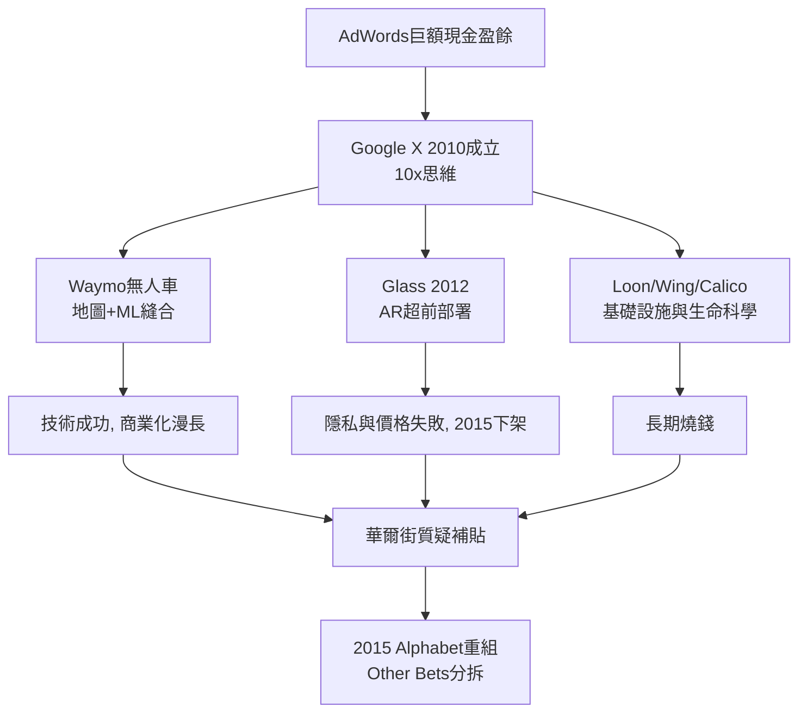

# 3.3 Google X 與登月計畫（2010-2015）

2010 年，Google 在加州山景城一個神祕地點成立 Google X（後改名 X），由史丹佛教授塞巴斯蒂安·史朗（Sebastian Thrun，無人車之父）與「登月隊長」阿斯特羅·泰勒（Astro Teller）領導。它的使命只有一句話：做「10 倍好、而不是好 10%」的事（10x thinking）。當 AdWords 每年帶來數百億美元、主業已無懸念，創辦人要回答的問題變成：**下一台印鈔機在哪裡？以及，一家搜尋公司憑什麼定義未來？**

X 的產品線像科幻小說目錄：無人車 Waymo（2009 年立項，當時叫 Chauffeur）、Google Glass（2012 年發布）、Project Loon 平流層氣球上網、Wing 無人機送貨、Calico 抗衰老、Verily 生命科學、DeepMind 之外的機器人收購（Boston Dynamics 曾短暫入彀）。2012 年的 I/O 大會上，佩奇戴著 Glass 跳傘直播，把「增強現實」推上全球頭條；同年無人車已在內華達州拿到合法上路牌照。技術上，X 把 Google 在 1.3 種下的分散式運算、地圖高精度定位（3.1）、Android 感測器生態（3.2）全部縫合：無人車本質上就是「會跑的地圖 + 會看的機器學習」。

但 X 也暴露了 Google 的組織病。Glass 因隱私爭議（酒吧裡被稱為 Glasshole）、高價（1,500 美元）與實用性不足，在 2015 年黯然下架，成為「技術超前、產品與社會接受度落後」的經典教材。Loon、Wing 長期燒錢而商業化遙遙無期。華爾街開始質疑：搜尋廣告的利潤是否被拿去補貼創辦人的科幻夢？這正是 2015 年 Alphabet 重組（4.1）的直接導火線——把「登月業務」（Other Bets）從財報中分拆，讓市場看見主業的利潤，也讓登月計畫自負盈虧。

從技術史看，X 最大的遺產不是某個產品，而是 Waymo。它證明了 Google 在深度學習爆發前夜（4.2）已經把「大規模資料 + 大規模運算 + 現實世界感測」連成一線，為 Transformer 時代的自駕與機器人研究鋪了路。

## 因果鏈

- **前因**：2.2 的廣告現金牛提供了燒錢本錢；3.1 的地圖與資料中心、3.2 的 Android 感測器生態提供了技術零件；佩奇對「系統效率」的少年執念（1.1）提供了文化正當性——登月不是任性，而是創辦人性格的必然。
- **後果**：商業上的挫敗（Glass 下架、燒錢爭議）直接逼出 Alphabet 的財務紀律改革（4.1）；技術上的積累（無人車的感知與決策系統、眼鏡的光學與端側運算）則成為 AI 時代（4.2、4.3）的重要人才與方法儲備；X 的成敗也讓公司學到一課：技術 → 產品 → 商業之間，缺了「社會接受度」這一環，再強的技術也會墜落——這一課在 Gemini 與 AI 搜尋（5.1）的推送中一再重演。
