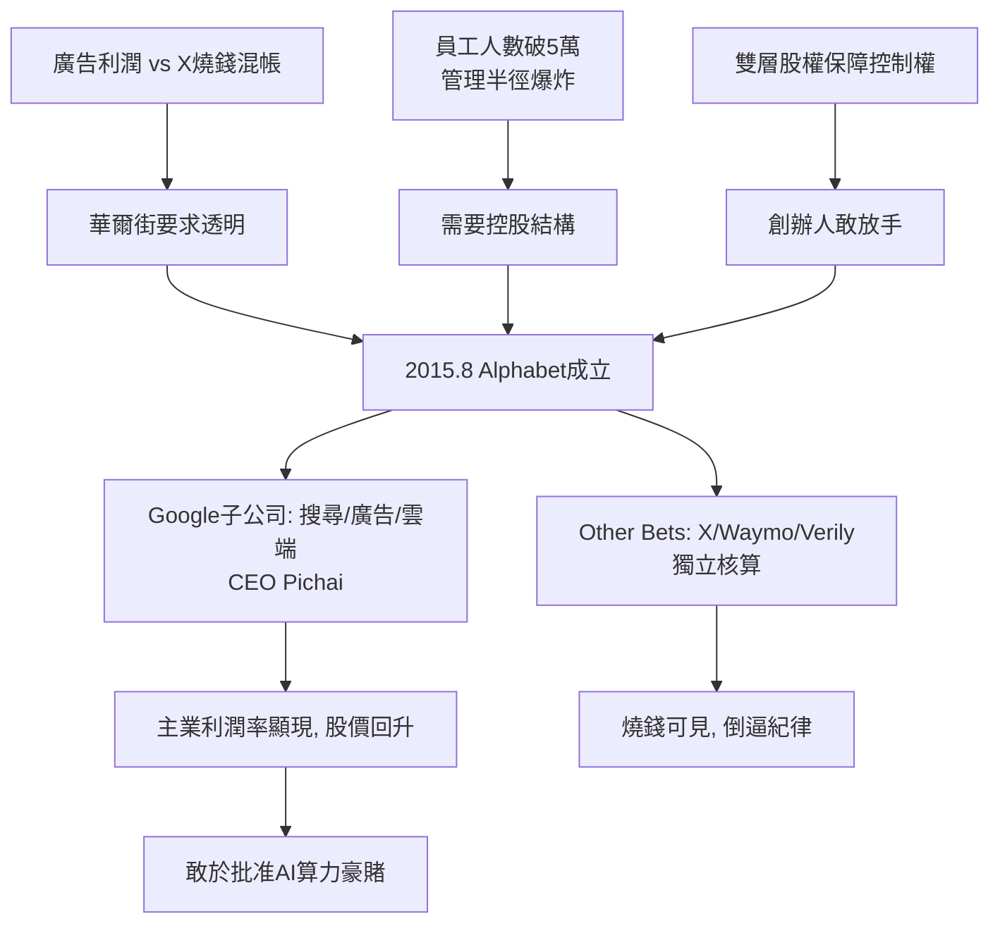

# 4.1 Alphabet 重組（2015）

2015 年 8 月 10 日，佩奇發布一封公開信，宣布成立 Alphabet Inc. 作為 Google 的母公司：原 Google 的搜尋、廣告、Android、YouTube、雲端保留在「Google」子公司內，由桑達爾·皮查伊（Sundar Pichai）出任 CEO；無人車、Calico、Verily、X、Nest、Fiber 等登月業務劃為 Other Bets 獨立子公司；佩奇任 Alphabet CEO，布林任總裁。這不是改名遊戲，而是一次**組織對商業現實的承認**。

直接動因有三。第一，華爾街壓力：2014 年 Google 營收 660 億美元，幾乎全來自廣告，但財報把搜尋利潤與 X 的虧損混在一起，投資人無法估值，分拆後主業利潤率一目了然。第二，管理半徑：員工人數突破 5 萬，從搜尋到抗衰老橫跨十幾個行業，單一 CEO 已無法兼顧，需要「控股公司 + 事業部 CEO」的結構。第三，創辦人意志：雙層股權（2.3）讓佩奇、布林不必擔心控制權，可以放心地把日常經營交給皮查伊，自己退到更高層思考「下一個 10 倍機會」——AI。

重組的財務效果立竿見影：Other Bets 的虧損被單獨列出（2016 年虧損 36 億美元），主業 Google 的營業利潤率超過 30% 重獲市場信任，股價在重組後一年上漲近四成。更深遠的是人事效果：皮查伊的上位標誌著 Google 從「創辦人 + 明星工程師」驅動轉為「職業經理人 + 平台治理」驅動。2019 年佩奇、布林進一步淡出日常管理，皮查伊兼任 Alphabet CEO，Google 正式進入「後創辦人時代」。

從因果鏈看，重組是 3.3 登月燒錢的止血帶，也是 4.2、4.3 AI 豪賭的發令槍：只有把主業現金流與登月虧損分開，董事會才敢批准每年上百億美元的 TPU 與資料中心投入——而那正是 Transformer 與 Gemini 的算力地基。

## 因果鏈

- **前因**：技術上，3.1–3.3 的產品爆炸把公司撐成 Conglomerate；商業上，廣告單一收入結構使登月虧損格外刺眼；組織上，2.3 的雙層股權讓創辦人有恃無恐，可以做華爾街不喜歡但長期正確的事。
- **後果**：重組釋放的財務透明與管理頻寬，直接支撐了 DeepMind 的整合與 TPU 的大規模部署（4.2）；皮查伊的上位則決定了 4.3 面對 ChatGPT 突襲時的應對風格——穩健、平台化、但也因謹慎而慢半拍；Alphabet 結構本身，後來也成為 5.2 反壟斷訴訟中「分拆 Google」主張的現成藍圖，極具諷刺意味。
