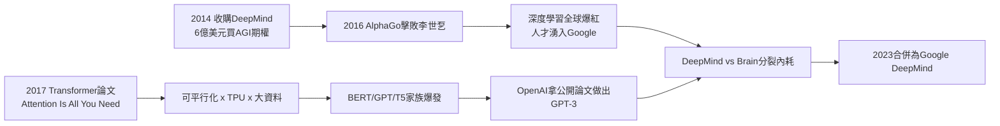

# 4.2 DeepMind 與 Transformer 論文（2014-2017）

Google 的 AI 王座由兩塊基石砌成：一塊是買來的，一塊是自己寫的。買來的是 DeepMind，寫的是 Transformer。

2014 年 1 月，Google 以約 6 億美元收購倫敦新創 DeepMind——當時它沒有產品、沒有營收，只有一群做遊戲 AI 與神經科學的博士。創辦人戴密斯·哈薩比斯（Demis Hassabis）堅持兩個條件：技術必須用於善（成立 AI 倫理委員會）、Google 不得將其用於軍事。這筆收購在當年看來昂貴而浪漫：佩奇買的不是公司，是「通用人工智慧（AGI）」的期權。回報來得很快：2016 年 AlphaGo 以 4:1 擊敗李世乭，全球直播觀看人次破億，「深度學習」一夜之間從學術名詞變成國家戰略；2017 年 AlphaZero 從零自學橫掃棋類，證明了「算力 + 自我對局」範式的威力。DeepMind 像一面旗幟，告訴全世界最聰明的大腦都在 Google。

自己寫的那篇論文更傳奇。2017 年 6 月，Google Brain 與 Google Research 的 8 位作者發表《Attention Is All You Need》，提出 Transformer 架構：拋棄循環神經網路（RNN），只用自注意力機制（self-attention）建模序列關係：

$$\text{Attention}(Q, K, V) = \text{softmax}\left(\frac{QK^T}{\sqrt{d_k}}\right) V$$

多頭注意力讓模型同時從不同子空間捕捉依賴，而完全可平行化的結構使它能吃下前所未有的算力——這正是 Google 最不缺的東西（GFS/MapReduce 以來的資料中心傳統 + 自研 TPU）。Transformer 很快衍生出 BERT（2018，Google 自家）、GPT（OpenAI）、T5 等家族。有史學家戲言：Google 發明了蒸汽機，卻把火車票送給了別人——因為論文完全公開，OpenAI 拿著它做出了 GPT-3。

這兩塊基石的組織學矛盾在 2023 年前後爆發：DeepMind（倫敦，做 AGI）與 Brain（山景城，做產品）互相競爭、重複投入，直到 2023 年 4 月才合併為 Google DeepMind。分裂的八年，正是 OpenAI 從追趕到反超的八年。

## 因果鏈

- **前因**：技術上，1.3 的分散式運算傳統與 3.1 的大資料積累，使「用算力暴力美學訓練大模型」成為 Google 的本能；商業上，4.1 重組後的現金流使 6 億美元收購與 TPU 研發不再傷筋動骨；組織上，X 的登月文化（3.3）讓「為 AGI 下注」顯得理所當然。
- **後果**：AlphaGo 的勝利把 AI 從實驗室推向地緣政治，迫使各國政府開始監管（5.2 的前聲）；Transformer 的公開則親手武裝了最危險的對手 OpenAI，直接引爆 4.3 的 ChatGPT 危機；內部雙頭競爭的教訓，最終以 2023 年大合併收場，為 Gemini（5.1）提供了統一的組織地基。技術 → 產品 → 商業 → 組織的鏈條在此完整轉了一圈：一次慷慨的開源，改寫了下一個十年的競爭格局。
