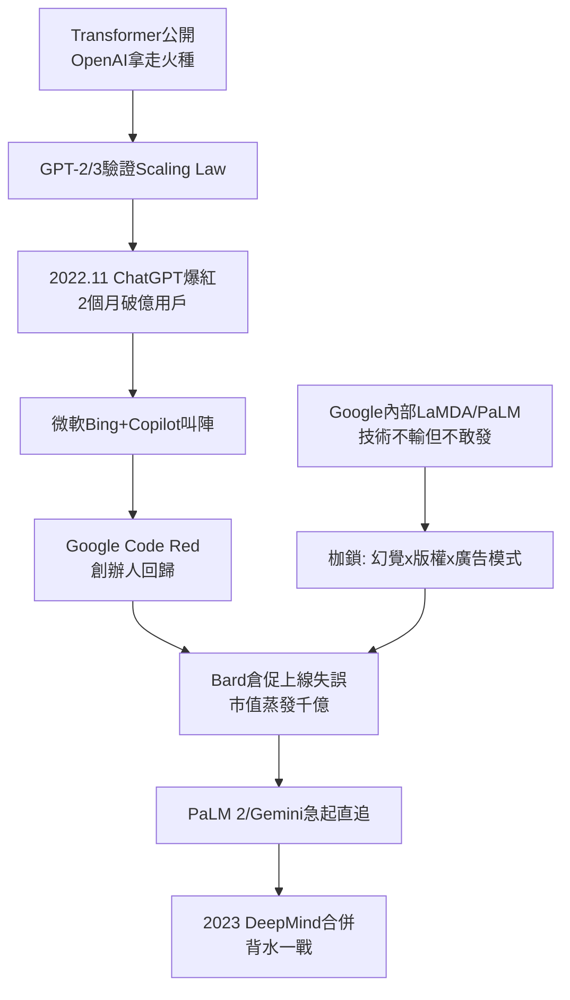

# 4.3 與 OpenAI 的競爭（2019-2023）

諷刺的是，Google 最大的 AI 對手，是自己親手養大的。OpenAI 2015 年由馬斯克、奧特曼等人創立，初衷正是「防止 Google 壟斷 AGI」；它早期最大的技術禮物，就是 Google 公開的 Transformer（4.2）；它早期最大的算力靠山，是微軟 2019 年起上百億美元的投資——而微軟投資 OpenAI 的動機，正是要用 AI 打破 Google 在搜尋與生產力軟體上的壟斷。一場圍繞 Google 的包圍網悄然成形。

2019–2022 年是溫水煮青蛙期。OpenAI 沿著 GPT-2、GPT-3 把「大力出奇蹟」（scaling law）走通，Google 內部其實早有同等甚至更強的模型：LaMDA（2021，對話）、PaLM（2022，540B 參數）。但 Google 不敢發：搜尋品質團隊擔心幻覺污染資訊生態，法務擔心版權與隱私訴訟，廣告團隊擔心聊天機器人繞過連結、摧毀 AdWords 的點擊模式——**印鈔機成了創新的枷鎖**。2022 年工程師 Lemoinne 聲稱 LaMDA 已有意識而遭停職，更讓公司對外發布如履薄冰。

2022 年 11 月 30 日，ChatGPT 上線，兩個月月活破億，成為史上成長最快的消費產品。微軟 2023 年 2 月把 GPT-4 接入 Bing 與 Office Copilot，公開叫陣「要讓 Google 跳舞」。Google 內部發布「紅色警報」（Code Red），佩奇、布林罕見回歸一線督戰，皮查伊把 Bard（後改名 Gemini App）倉促上線——2023 年 2 月巴黎發布會上 Bard 答錯韋伯望遠鏡問題，市值一天蒸發 1,000 億美元，成為「慢半拍 + 倉促追趕」的雙重羞辱。直到 2023 年 5 月 PaLM 2 與 12 月 Gemini 1.0 發布，Google 才在多模態與長上下文上扳回技術均勢，但「AI 領導者」的心智地位已被 OpenAI 奪走。

這一役暴露了 Google 的結構性困境：擁有最好的模型、最多的資料、最強的算力，卻因為要守護搜尋的準確性與廣告的商業模式而不敢 All in。創新者的兩難在此具象化為：前一波技術的成功（搜尋 + 廣告），正是下一波技術（生成式 AI）的組織阻力。

## 因果鏈

- **前因**：技術上，4.2 的慷慨開源武裝了對手；商業上，2.2 的廣告飛輪太成功，使任何「不用點連結」的問答形式都像自我革命；組織上，4.1 的職業經理人治理偏重風險控制，壓制了 3.3 式的莽撞登月精神。
- **後果**：ChatGPT 的突襲迫使 Google 合併 DeepMind、大舉投入 TPU 與資料中心，直接開啟 5.1 的 Gemini 時代；微軟與 OpenAI 的結盟則把 AI 競爭上升為雲端大戰，Google Cloud 終於從配角變成戰略要地；更深遠的是，搜尋「十條藍色連結」的典範開始動搖——公司被迫回答 1.1 以來從未回答過的問題：如果答案直接生成，廣告往哪裡放？這正是第五章所有掙扎的起點。
