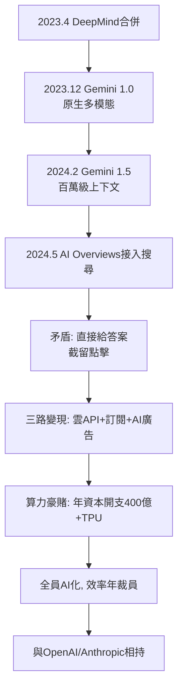

# 5.1 Gemini 時代（2023-2024）

2023 年 12 月，Google 發布 Gemini 1.0——第一個「原生多模態」（natively multimodal）大模型，文字、圖像、音訊、影片、程式碼在同一個 Transformer 中聯合訓練，而非後期拼接。技術宣言意味濃厚：這是合併後的 Google DeepMind 交出的第一份答卷，也是對 GPT-4 的正面回應。2024 年 2 月 Gemini 1.5  Paper 拋出 100 萬 token 上下文（後擴至 200 萬），把「把整本書、整個程式碼庫丟進提示詞」變成現實；2024 年 5 月 I/O 大會上，AI Overviews（AI 摘要）正式接入美國搜尋，Project Astra 展示即時多模態助手——搜尋框第一次變成了「會看、會聽、會說」的存在。

商業邏輯隨之改寫。傳統搜尋是「十條連結 + 廣告競價」，AI Overviews 卻是「直接給答案」——點擊被截留，出版商與廣告主同時恐慌。Google 的解法是三路並進：雲端（Vertex AI 賣 API 與 TPU 算力，向企業收費）、訂閱（Gemini Advanced，每月 19.99 美元，綁定 2TB 雲端空間）、以及把廣告植入 AI 答案（2024 年開始測試在 Overviews 中插入贊助卡片）。技術 → 商業的鏈條至此出現斷裂再縫合：公司一邊用 AI 蠶食自己的搜尋，一邊試圖用新的廣告形式把自己救回來。

組織上，Gemini 時代是「全員 AI 化」。2023–2024 年，搜尋、Android、Pixel、Workspace 全部改向 Gemini 匯報；TPU v5p 量產、資料中心資本開支一年超過 400 億美元；裁員與「效率年」同步進行——2024 年初裁員上萬人，把省下的錢投入算力。這是 Alphabet 成立以來最劇烈的資源重分配：從「廣告養登月」變成「廣告養算力」。

Gemini 並未終結競賽。2024 年 OpenAI 發布 GPT-4o 與 o1 推理模型，Anthropic 的 Claude 在長文與程式碼上緊咬，開源的 Llama 則從下方蠶食。但 Gemini 至少證明了一件事：大象也能跳舞——只要 Code Red 的警鐘夠響。

## 因果鏈

- **前因**：技術上，4.2 的 Transformer 與 TPU 積累使多模態與長上下文成為可能；組織上，4.3 的羞辱（Bard 失誤）與 DeepMind 合併提供了背水一戰的決心；商業上，雲端業務的崛起（3.1 的 App Engine 終於長大）提供了除廣告外的第二變現口。
- **後果**：AI 摘要直接衝擊出版生態與廣告點擊率，把 Google 推向 5.2 反壟斷法庭上最難回答的問題——「你既是裁判（排序）又是球員（給答案），還讓人活嗎？」；而算力豪賭的財務壓力，則決定了公司未來數年必須維持廣告高利潤，進而加劇 5.3 的資訊秩序爭議。技術救了公司，也把公司推向更深的矛盾。
